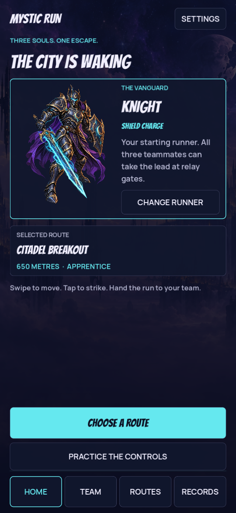
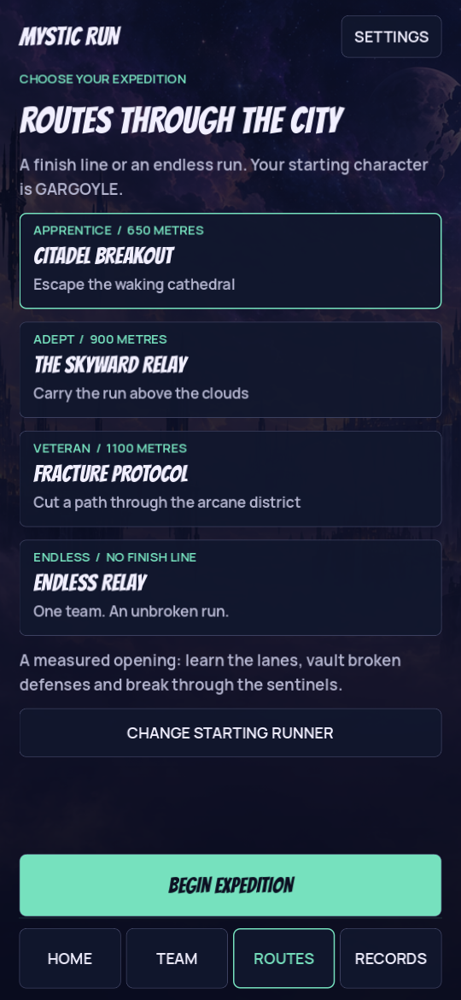

# Mystic Run

A Lamont Labs Android forward runner blending dark fantasy and futuristic magic.
Knight, Gargoyle and Witch hand the run to one another through relay routes.

Version 0.3.0 rebuilds navigation and core game feel after owner feedback. The game
remains a development alpha below its final premium production target.

## Download

[Download the signed Mystic Run 0.3.0 APK](https://github.com/Lamont-Labs/Mystic-Run/releases/download/v0.3.0-build1006/Mystic_Run_0.3.0_GitHub_Build1006.apk) or open [the release page](https://github.com/Lamont-Labs/Mystic-Run/releases/tag/v0.3.0-build1006). It retains the previous package and signing identity.

## Actual rendered menus





These are native Godot screen captures from a scripted desktop review.

## Play flow

Home → Team → Routes → ready countdown → run → results. Persistent Home, Team,
Routes and Records tabs, settings, controls, credits and working Back paths are
included. Pause resumes or opens settings/controls and returns to the same run.

| Route | Goal |
| --- | --- |
| Citadel Breakout | Reach 650 m |
| The Skyward Relay | Reach 900 m |
| Fracture Protocol | Reach 1100 m |
| Endless Relay | Keep the run alive |
| Guided Practice | Perform six real controls, including a successful hit |

All three characters are available. Choose a starting runner before the level;
marked relay lanes hand the continuous run to another teammate. Each teammate has
its own power recharge. Results and route clears are saved in the local journal.

| Control | Action |
| --- | --- |
| Swipe left / right | Move one lane, including while airborne |
| Swipe up | Jump, with a short input buffer |
| Swipe down | Slide; in the air, land into a slide |
| Tap the open play area / Strike | Basic attack |
| Power | Charge / Wing Burst / Blink |
| Android Back | Navigate back or pause |
| Arrows / WASD, Space, E, Escape | Desktop controls |

See [the gameplay revision](docs/GAMEPLAY_AND_NAVIGATION.md) for the specific
control corrections. No physical-phone comfort or performance claim is made.

## Source and checks

Open project.godot in pinned Godot 4.7.2 standard, using Compatibility rendering.
No backend or game account is required.

```bash
godot --path .
godot --headless --path . --script tests/run_tests.gd
godot --headless --path . --script tests/runner_controls.gd
godot --headless --path . --script tests/gameplay_navigation.gd
godot --headless --path . --script tests/rig_motion.gd
godot --headless --path . -- --qa --qa-ticks=3600 --character=knight
```

The last command uses a disclosed automated input driver; repeat with Gargoyle
and Witch. Reports are in tests/evidence/. The existing scene_interactions.gd
entry point now runs native GUI and touch navigation checks, rather than directly
emitting button signals.

| Source | Purpose |
| --- | --- |
| game/main.gd | Scene, physical runner, combat, relay and run flow |
| game/front_end.gd | Native menus, navigation and journal |
| game/hud.gd | In-run HUD and countdown |
| game/gesture_input.gd | Pointer ownership, swipes and taps |
| game/encounter_director.gd | Seeded authored encounter phrases |
| core/course_catalog.gd | Playable expeditions and pace |
| core/run_core.gd | Fixed-tick state, score, cooldowns and completion |
| game/hero.gd and rig_motion.gd | Weighted characters and authored motion |

GitHub's Compile Android APK workflow produces an unsigned compilation with its
source/run/hash metadata. The preserved owner key signs it separately. The publish
workflow verifies exact signed bytes and exposes an installable APK under Releases.
Private signing keys and credentials are never committed. The optional manual
fully signed workflow needs owner-configured signing secrets.

## Art and ownership

Original game code, custom equipment, interface and synthesized audio: Lamont Labs.
Original generated character illustrations and distant city matte are used in the
actual game. Quaternius humanoid meshes and authored motion are CC0 1.0. Godot is
MIT licensed; Bangers, Cinzel and Manrope are SIL OFL. Notices are shipped in the APK.
See assets/ART_PROVENANCE.json and assets/models/quaternius/PROVENANCE.json.

The illustration quality is not a claim about production 3D model fidelity. Further
character detail, course set pieces, environment transitions and phone validation
remain necessary for the owner's Temple Run / Marvel Snap quality target.
