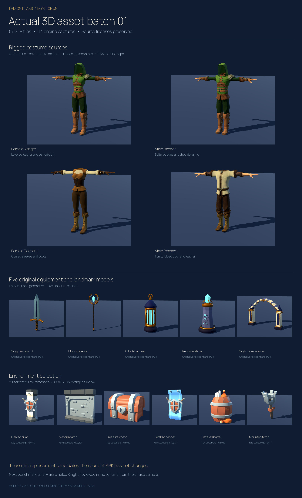

# MysticRun replacement asset batch 01

Lamont Labs · November 5 2026

The current game art remains below the owner's target. This checkpoint supplies actual meshes and textured costume sources for replacing weak visual components. Acquisition, file validation and desktop import review are complete. Character reconstruction, gameplay integration and physical-phone performance remain open.

## Saved starting point

The existing game is preserved at `46239afe06531b94971c4a9bb087d4d087663ddf`, including the Knight, Gargoyle, Witch, gameplay, progression and original update signing contract. Published build 1023 remains the existing-game update. The new asset work is on `art/asset-upgrade-batch-01`.

The repository and attached research report were read before selecting this batch. The review covered the current art direction and development queue, master blueprint and its superseding directions, material checkpoint, update identity, asset registry and foundry, character generators, playable hero and rig adapter, world geometry and district scenery. The report's earlier assumptions that repository and build access were unknown are superseded by the inspected source baseline.

## Delivered files

| Category | GLB files | Contents | License |
| --- | ---: | --- | --- |
| Original equipment and landmarks | 5 | Skyguard sword, Moonspire staff, Citadel lantern, Relic waystone, Skybridge gateway | Lamont Labs original work |
| Environment selection | 28 | Carved walls, arches, pillars, decorated paving, stairs, banners, chests, barrels, crates, torches, rubble and props | KayKit CC0 1.0 |
| Complete outfit assemblies | 4 | Male and female Ranger and Peasant outfits with source rigs and PBR maps | Quaternius CC0 1.0 in this exact Standard archive |
| Separate clothing parts | 20 | Bodies, arms, legs, boots, hoods and pauldrons for kitbashing | Same explicit archive dedication |

There are 57 delivered GLB files. The four outfits assemble the modular parts; this count does not imply 57 unrelated designs or four finished new game characters.

The clothing assemblies deliberately omit heads, as the publisher specifies. They need a compatible head, hair, hero-specific design work and animation validation. The Ranger is a costume source, not an accepted replacement for the Knight. No new Gargoyle replacement is included in this batch.

The outfit assemblies retain 65-bone source rigs. Their exported geometry is 12,894 to 26,982 triangles per complete outfit. Complete outfit maps are at most 1024 pixels per side; isolated part review files use 512-pixel maps. Color, normal and roughness or ORM maps remain embedded. The current assembled exports use multiple mesh surfaces and require a draw-call/material consolidation decision before runtime admission.

The five original models use authored vertex paint and two or three material groups. Their geometry ranges from 668 to 5,004 triangles. The original geometry, painted color and PBR controls are delivered in the GLBs; the standalone Godot viewer explicitly enables vertex color on every original surface to avoid a first-material import omission observed during review.

## Source and rights evidence

- KayKit source: `KayKit-Game-Assets/KayKit-Dungeon-Remastered-1.0`, commit `b0ca9bd96a8072ab36a3a5464f00ed1e06a16d07`. The source selection and exact downloaded file hashes are in `art/asset_batch_01/kaykit-dungeon.lock.json`. The original license and README are preserved.
- Outfit source: the public free Standard edition of Modular Character Outfits Fantasy. The downloaded archive is 294,347,394 bytes; SHA-256 `c3468b18871cc8c8f05ab14df7712baf22cb9f389cbd870babf130e595187f70`. Its `License_Standard.txt` explicitly dedicates this edition under CC0 1.0. The archive receipt, selected source paths and exact hashes are in `art/asset_batch_01/quaternius-outfits.lock.json`. This does not assign CC0 to other Quaternius downloads.
- Original work: the five new prop generators are in `tools/build_asset_batch01.py`; their rights statement is in the batch licenses directory. The new geometry does not contain downloaded meshes.
- Acquisitions and local Blender generation cost zero dollars. No paid generation or purchase was submitted.

## Actual geometry review



The viewer imported all 57 files in Godot 4.7.2 and rendered a front and rear view of each, producing 114 captures. The overview and catalog sheets are composed from those actual engine captures. All individual captures can be regenerated from the delivered review project.

The file inspector passed GLB version and chunk bounds, embedded buffer and texture dependencies, finite positions and normals, index bounds, skin joint and inverse-bind bounds, texture dimensions, source correspondence and exact file hashes. Triangle totals count mesh instances rather than only unique mesh definitions. The machine-readable catalog is `art/asset_batch_01/review/asset_catalog.json`.

The existing game's independent checks passed 427 gameplay-core assertions and 51 admitted-asset checks. This task leaves `game/`, `core/`, `content/`, the current runtime assets, Android package and signing configuration unchanged. The saved test receipt is `art/asset_batch_01/verification-current-game.json`.

Desktop captures use the GL Compatibility renderer and software Mesa. They establish successful import and visible source geometry. They do not establish animation quality, sustained Android frame rate, thermal behavior or final owner art acceptance. The new outfits are reviewed in their source pose; their weights have not been exercised through MysticRun locomotion in this checkpoint.

## Open the delivered batch

Open `art/asset_batch_01/review/project.godot` in Godot 4.7.2 and run it. Left and right change the asset; Space rotates it; Escape closes the viewer. The review project has no game-save access. The asset ZIP includes the GLBs, viewer, catalog, licenses and review sheets.

The asset checkpoint on `art/asset-upgrade-batch-01` preserves the source tools, locks, catalogs, license evidence and review sheets. The delivered ZIP contains the complete source tools and generated asset files, which can also be rebuilt with the commands below. Generated output and large publisher source caches are excluded from Git and from the Android game's import tree.

## Rebuild from the saved sources

Run from the repository root with Blender 4.3.2 and the pinned Godot 4.7.2 editor available:

```bash
python tools/acquire_asset_batch01.py
python tools/download_outfit_source.py
blender --background --python tools/build_asset_batch01.py
blender --background --python tools/prepare_outfit_assets.py -- --archive build/asset_sources/quaternius-fantasy-standard.zip
python tools/inspect_asset_batch01.py
godot --headless --editor --path art/asset_batch_01/review --import --quit
godot --path art/asset_batch_01/review
```

Use the pinned editor binary in place of `godot` if the default command is another version. Public downloads require network access. A publisher change, refused download or hash mismatch stops acquisition rather than accepting a different edition. The runtime game makes no asset downloads.

## Next task

The owner's subsequent correction makes the supplied concept sheet the exact character-design target. The Ranger and Peasant outfits are construction resources, not accepted cast replacements. The owner is considering comic and cleaner illustrated rendering references; the final style remains undecided. Read `CHARACTER_FIDELITY_AND_STYLE.md` and `HANDOFF_NEXT_CHAT.md` before continuing.

First proposed work is a controlled same-Knight comparison in the original concept finish, a textured comic finish and a cleaner illustrated finish. After the owner selects the rendering direction, build one faithful Knight mesh with an expressive head, the concept's layered armor and its equipment. Compare actual engine front, rear, running, sliding, jumping and chase-camera views before applying the approach to the Witch and Gargoyle. Material consolidation, full motion checks and phone profiling follow that visual benchmark.
