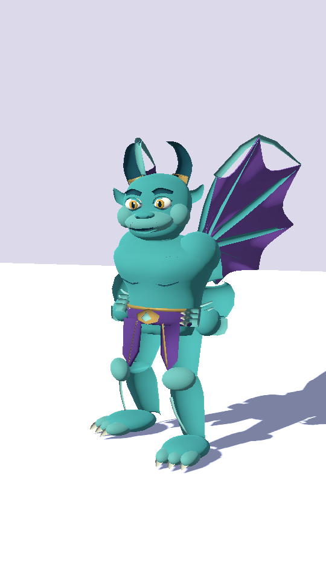
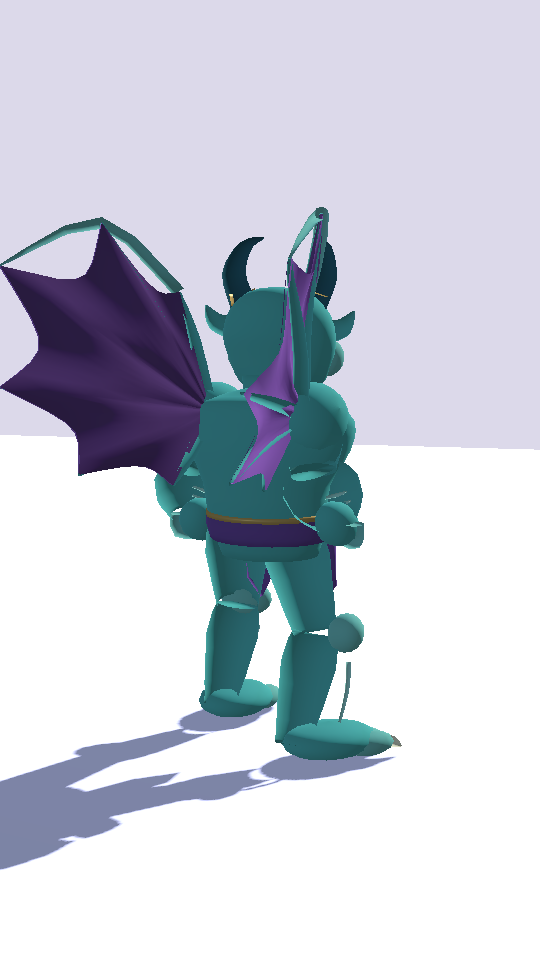
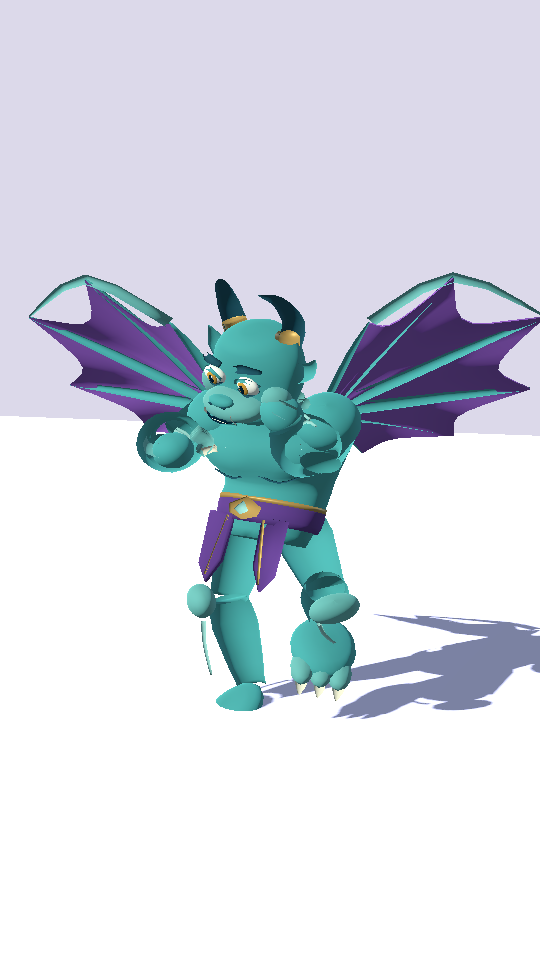
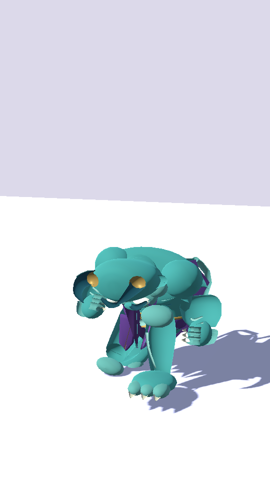
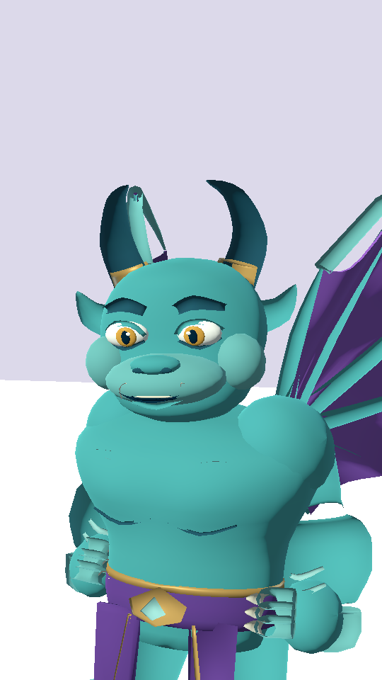
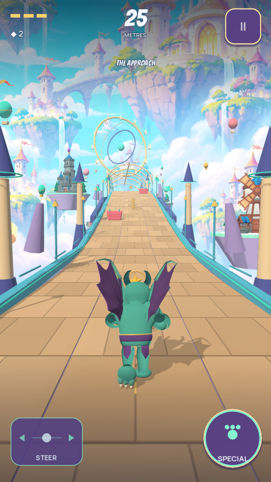

# Authored Gargoyle checkpoint

Lamont Labs · November 4, 2026

This is the first saved Gargoyle replacement milestone following Knight commit `90fcdc37eb4e6df392a296b32221ab59a4b54c6f`. It supplies an independently shaped, weighted creature instead of the former runtime additions around a shared humanoid body. This checkpoint is completed and saved before beginning the Witch replacement.

## Implemented model

The Gargoyle has a broad stone torso, sculpted muzzle and brows, swept horns and ears, oversized forearms, gripping fingers, three-toed feet, a layered plum sash and gold ornaments. Curved wing membranes have front/back thickness, scalloped outlines and supporting spars. Four added control bones deform the wings for running, airborne traversal and sliding.

Five imported facial morphs supply blink, smile, focus, surprise and hurt. They use the existing actor's action-expression controller. The older procedural Gargoyle geometry is removed from the runtime builder. The admitted humanoid rig and authored motion remain the foundation; the visible body mesh is original project geometry.

The complete exported creature contains **22,722 source triangles**, **13,089 source vertices**, **69 bones** and **one material surface**. Its runtime GLB is 1,616,856 bytes, SHA-256 `0c4c077a7ee55a763f53698f9b0d88433537cde4818fc467044c44db801040ed`. UV-seam normals are averaged without changing paint regions, skin weights or facial indices. Rebuilding with Blender 4.3.2 produced byte-identical GLB bytes.

The new `tools/character_mesh.py` module supplies the deterministic geometry/export helpers. `tools/build_gargoyle_asset.py` authors this character. The registry retains the original rig's CC0 evidence and separately records the owner-authored geometry and wing controls. No new asset purchase, external account or runtime download is required.

## Actual engine frames

| Front | Rear | Wings unfolded |
| --- | --- | --- |
|  |  |  |

| Slide | Face | Actual gameplay |
| --- | --- | --- |
|  |  |  |

These are rendered from the same actor and imported model used by gameplay. The neutral stage and the gameplay camera are separate review views; they are not generated concept art. `tests/preview_authored_character.gd` reproduces the stage and the generalized `tests/preview_character_benchmark.gd` records any of the three runners without owner-save writes.

## Pose clearance and validation

The slide requires a dedicated head tuck and a wing fold that accounts for the animated torso's current pose. Tests skin the actual imported vertices, apply active facial morphs and actor transforms, and compare the full creature against the beam's 1.255-metre lower trim.

Measured wing span is approximately **1.402 m running**, **2.659 m airborne**, and **0.557 m sliding** in the reviewed poses. The highest complete-character point across the tested slide contact interval is **1.186 m**. Adding the maximum 0.014 m decorative idle offset still leaves it below the lower trim. These are flat-course desktop pose checks; they are not certification of every terrain transition or physical-phone behavior.

Local checks passed **843 Godot assertions**: the preceding 828 plus 15 actual Gargoyle mesh/skin/wing/face checks. Twenty Python tests and 47 asset inventory checks passed. All three 3,600-tick basic-only runs completed with zero damage, deaths, handoffs or off-screen runner-centre ticks. The recorded eight-second Gargoyle gameplay sample covered 148.193 metres with zero damage or switches.

The previously saved Knight GLB remains byte-identical. Core rules, course content, progression and save structure remain as before. This milestone is an art and presentation iteration; final texture polish, physical-phone performance and owner art review remain open.

## Reproduction

```bash
blender --background --python-exit-code 1 --python tools/build_gargoyle_asset.py
python3 tools/asset_foundry.py verify
Godot_v4.7.2-stable_linux.x86_64 --headless --path . --editor --import --quit
Godot_v4.7.2-stable_linux.x86_64 --headless --path . --script res://tests/gargoyle_asset.gd
```
