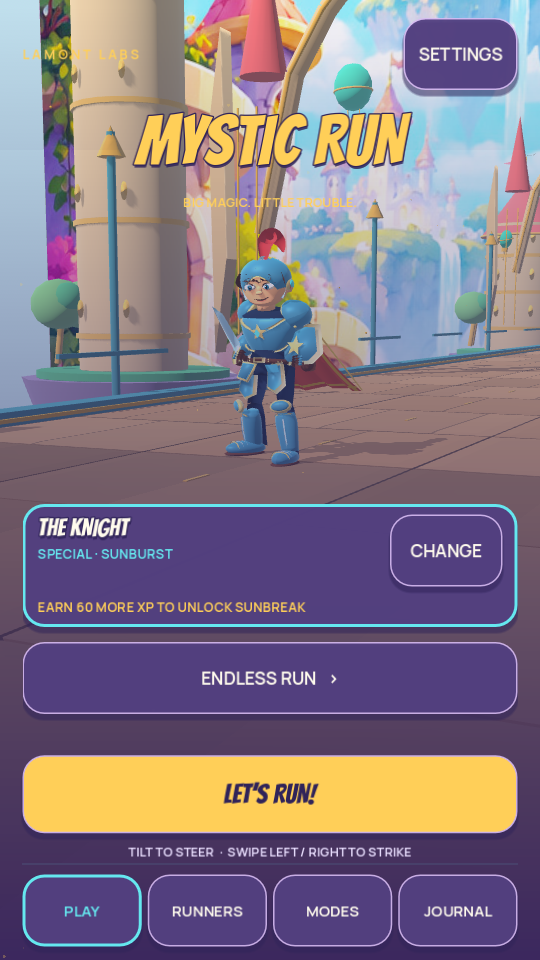
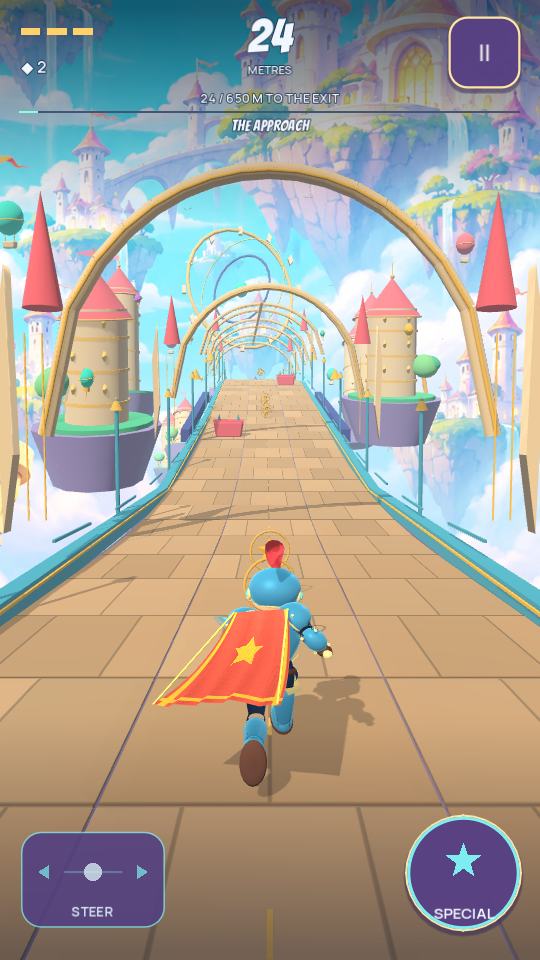
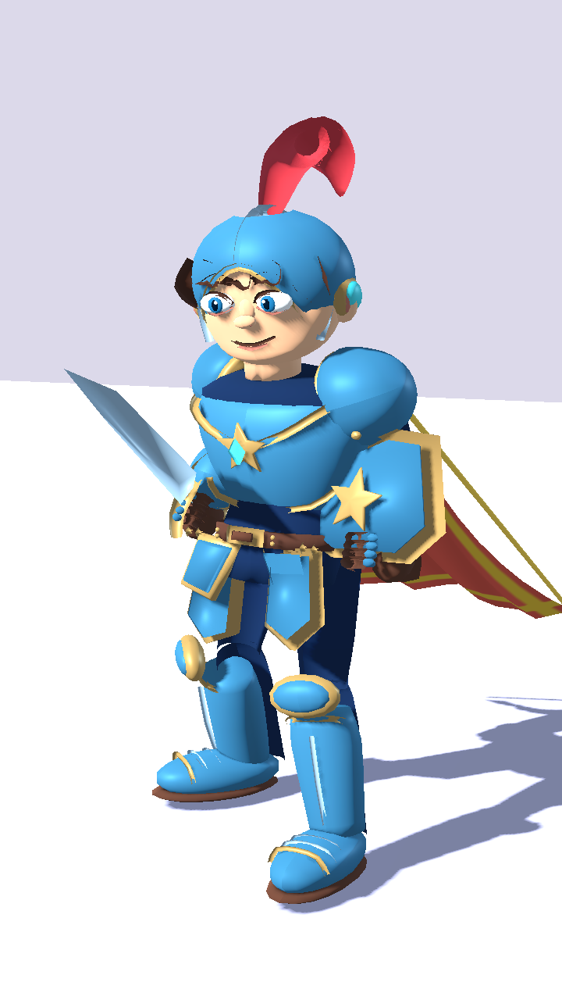
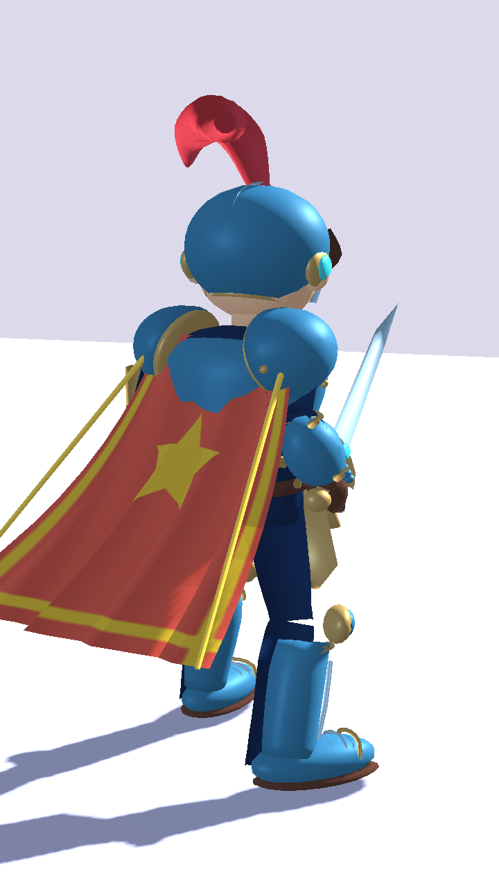
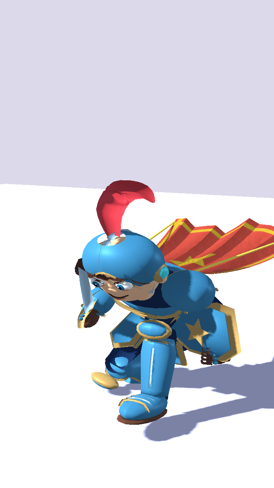

# Authored Knight — first playable replacement

Lamont Labs · November 3, 2026

This revision replaces the Knight's visible base body and runtime-built armor with a new exported, weighted character mesh. The existing CC0 skeleton and authored locomotion clips remain the animation foundation. It is a first playable art iteration, below the finish of the approved concept reference. Gargoyle and Witch still use the preceding character treatment.

## Implemented

- Open rounded helmet, sculpted face, opaque eyes and irises, eyelids, brows, hair and a coral plume.
- Layered curved chest armor, shaped pauldrons, tassets, bracers, gloves, greaves and articulated toe plates.
- A closed-volume sword, shaped heraldic shield and corrected five-point cape star.
- Separate painted regions for skin, hair, enamel, metal, cloth, leather and eyes, carried by one main mesh material. Secondary UV coordinates carry metallic and roughness values.
- Imported Blink and PlumeSway morph targets, with Reduced Motion suppressing both cosmetic animations.
- A separate material instance for each hero/enemy so sentinel recoloring cannot leak into the playable Knight.
- One identical imported Knight asset in the opening screen, character stage and gameplay.

The main source mesh has **24,348 triangles**, **14,538 source vertices**, **65 skeleton bones**, **two morph targets** and **one material surface**. These counts exclude the separate cape, trim and import-generated LODs. The GLB is 1,333,720 bytes. Its exact digest is recorded in [asset provenance](../assets/characters/knight/PROVENANCE.json).

## Reproduction

With Blender 4.3.2 and the repository's CC0 skeleton present:

```bash
blender --background --python-exit-code 1 --python tools/build_knight_asset.py
```

The source generator creates the runtime GLB and provenance record under `assets/characters/knight/`, plus an editable Blender workshop file under `art/characters/knight/`. The generated workshop file is ignored by Git and Godot; the generator is its durable source. No private signing material belongs in those paths.

`game/hero.gd` loads the exported Knight and retains its existing public gameplay methods. `game/rig_motion.gd`, the core rules, controls, collisions, progression and saves are unchanged. The shared cloth shader's star shape is corrected for the existing capes.

## Actual engine evidence

These are actual Godot 4.7.2 Compatibility renders, rather than generated concept images:

| Opening screen | Gameplay |
| --- | --- |
|  |  |

| Front | Rear | Slide |
| --- | --- | --- |
|  |  |  |

The standalone character stage uses simple neutral desktop lighting. The opening and gameplay captures use the game's ordinary environment and HUD. Tests do not establish visual approval.

The existing rig suite now checks imported surface/morph structure, finite vertices, normalized skin weights, valid skin bindings, the 25,000-triangle first-pass ceiling and isolated sentinel materials. It retains the existing locomotion, combat layering, limb-length, slide, landing and Reduced Motion checks. `tests/preview_character_benchmark.gd` supplies a seeded sixty-second desktop run with disclosed automatic controls and no owner-save writes.

Completed local verification: **802 assertions passed** across core (427), controls (38), adventure/progression (125), navigation (148), tilt/elevation (35), and rig/asset integration (29). All three heroes completed their 3,600-tick basic-only scripted runs with zero damage, deaths, handoffs or off-screen runner-center ticks. Four Android policy checks and six release reconstruction checks also passed. See [regression result](verification_knight_first_pass.json).

The actual sixty-second desktop recording completed **1,312.707 meters** with zero damage, zero handoffs and the selected Knight preserved throughout. It records real terrain and encounters under automatic controls; [benchmark evidence](previews/knight-first-pass/benchmark.json) records its scope. Software-rendered capture speed is not an Android frame-rate measurement.

## Remaining art and device work

The model is visibly smoother and more legible than the previous runtime assembly. Its face, hairline, helmet transitions, armor construction and secondary motion still require refinement against the concept sheet. Color currently comes from authored vertex gradients; a painted bitmap texture atlas and facial expression set are not completed. The imported motion clips have not yet been replaced by a Knight-specific animation set.

The first-pass triangle ceiling is above the research brief's proposed 10,000–20,000 target. One main material and removed outline passes reduce some rendering work, but neither establishes phone performance. The actual phone's frame pacing, thermal behavior and full visible slide clearance still need direct verification. Desktop software-rendered timings are not Android benchmarks.

The next art work remains Knight refinement, followed by an independently shaped Gargoyle and Witch. This revision does not mark the full cast overhaul complete.
