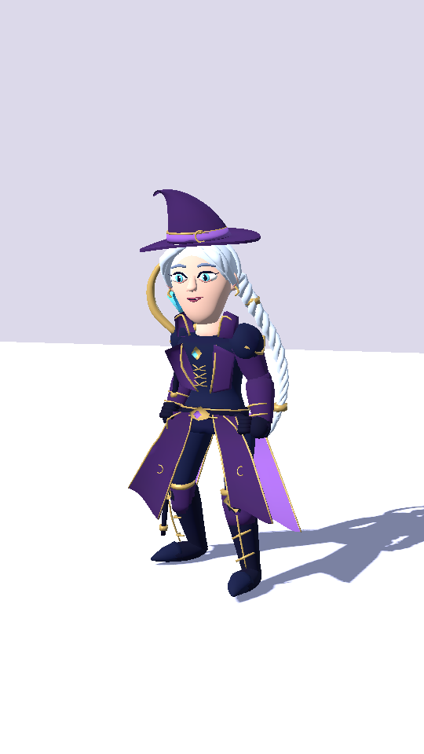
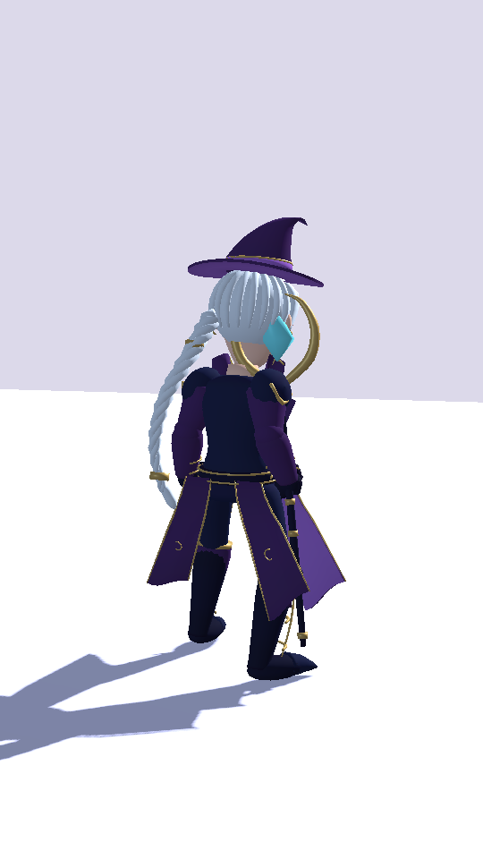
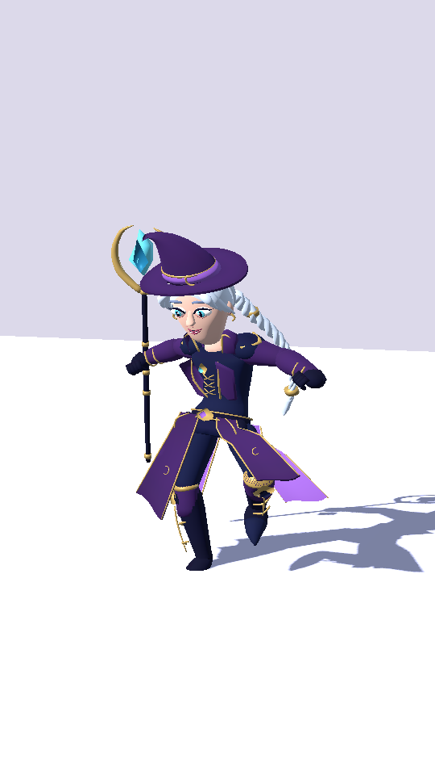
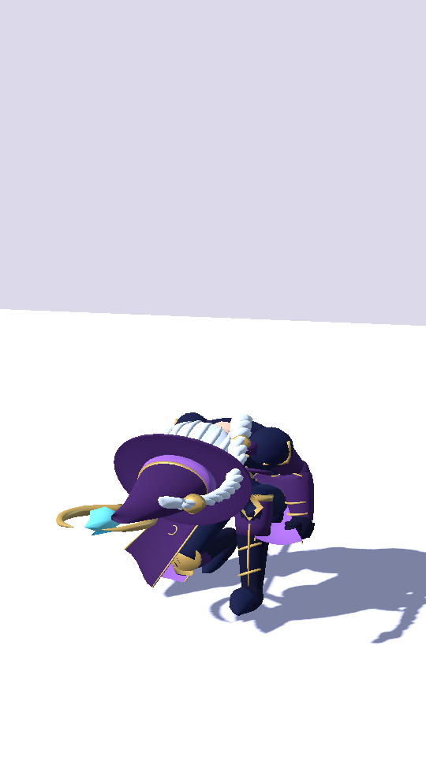
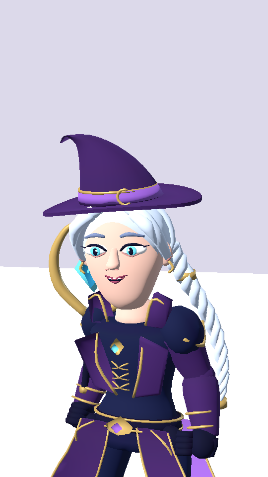
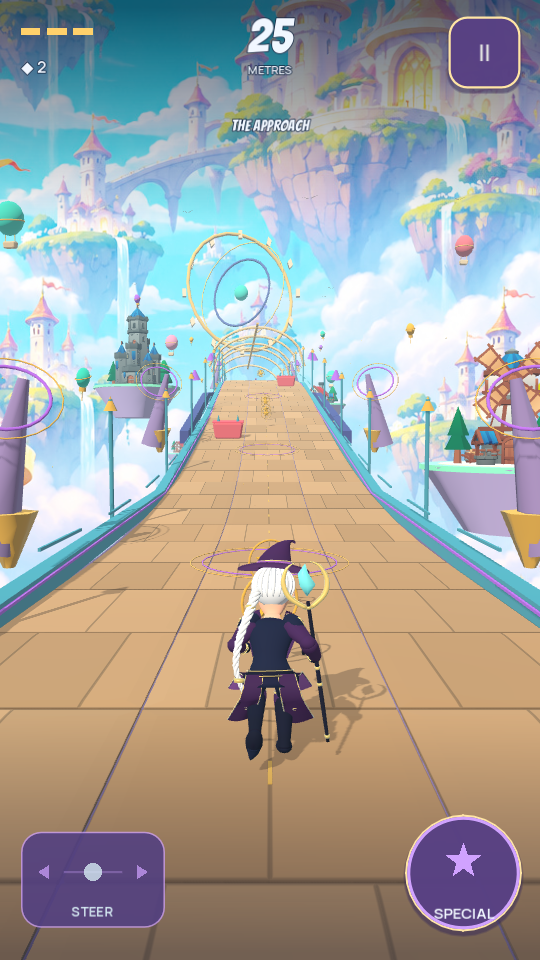

# Authored Witch checkpoint

Lamont Labs · November 4, 2026

This milestone follows saved Gargoyle commit `2e4606d6ae24941d8d825408eb3a815d59621863`. Both gameplay workflows and Android compilation passed for that checkpoint before Witch development began. This Witch replacement is saved as a separate commit on `quality/free-asset-foundry`.

## Implemented character

The Witch now has original visible geometry: a shaped face, cyan eyes, silver hair and a three-strand braid, a compact crooked hat, a high collar, a tailored plum coat with violet lining, gloves, tall boots, gold piping and a crescent crystal staff. Her source body is no longer the shared base mesh with runtime costume additions.

The existing admitted CC0 female skeleton and authored motion are retained. Two new braid controls provide restrained secondary motion; a third control retains the staff's actual hand grip while allowing a casting sweep and horizontal slide pose. The entire hat, braid and staff tuck with the crouch. Coat panels include front/back surfaces and closed borders; their lower weights follow the legs to reduce sprint intersections.

Blink, Smile, Focus, Surprised and Hurt are imported facial morphs. Existing action state selects the expression. Reduced Motion stops decorative braid sway and blinking while retaining the readable action face. The former procedural Witch builder, separate legacy hair, sash and decorative aura are removed. Gameplay spell effects, power rules, collision, progression and save structure are preserved.

## Source and budget

| Property | Measured value |
| --- | --- |
| Source triangles, complete character and equipment | 27,854 |
| Source vertices | 16,059 |
| Material surfaces | 1 |
| Painted material regions | 13 |
| Bones | 68: 65 retained, 3 added |
| Facial morphs | 5 |
| Runtime GLB bytes | 1,785,784 |

The final GLB SHA-256 is `cc77fece7aea17fe1d23da29ea85107abd10701d4754753312c666e0a7c27632`.

`tools/build_witch_asset.py` authors the model using `tools/character_mesh.py`. Its outward tube-face option corrects the visible hair strands, braid, piping and staff surfaces. Older saved character derivatives retain their original authoring option for reproducible reconstruction. Rebuilding the final Witch with Blender 4.3.2 produced byte-identical GLB bytes. Knight and Gargoyle model bytes are unchanged by this milestone; rebuilding Gargoyle through the revised shared helper also preserved its bytes.

The registry retains the original rig's CC0 evidence and separately records the original visible mesh and control bones. No additional download, paid asset or external account is required. The inventory now covers six entries and 26 runtime files, with 49 rights/hash/dependency checks.

## Actual engine review

| Front | Rear | Airborne |
| --- | --- | --- |
|  |  |  |

| Slide | Face | Actual gameplay |
| --- | --- | --- |
|  |  |  |

These frames use the imported gameplay actor, its actual skin and the project renderer. The neutral stage exposes silhouette and face details; the chase camera shows the same character during a seeded automated run. They are development evidence rather than concept art or owner art approval.

## Verification

The combined local suites passed **862 Godot assertions** and **20 Python tests**. The 19 Witch-specific assertions inspect actual imported geometry, normalized weights, finite and localized facial morphs, geometric eye closure, staff grip, braid motion, Reduced Motion, expression priority and the complete skinned crouch.

Across the sampled slide contact interval, the complete Witch's highest point is **1.1404 m**. Even with an additional conservative 0.014 m idle margin it stays below the actual beam's **1.255 m** lower trim. The steady full slide reaches approximately **1.0596 m**. Measured staff-to-hand grip error through casting is below **0.001 mm**. These are sampled flat-course desktop checks, not a guarantee for every terrain transition.

All three 3,600-tick basic-only runs completed 1,311.507 m with zero damage, deaths, involuntary handoffs or off-screen runner-centre ticks. The final Witch mesh was also checked after the last panel-weight revision. Removing the old runtime parts reduced this scene's node count from 298 to 266; this is a structural count, not an Android frame-rate measurement.

`docs/verification_witch.json` binds the evidence to the final source hashes. Final texture/material polish, mobile LOD review, sustained physical-phone testing and an owner-signed Android release remain open. This milestone does not merge the branch, replace the signing key or publish a Play release.

## Reproduction

```bash
blender --background --python-exit-code 1 --python tools/build_witch_asset.py
python3 tools/asset_foundry.py verify
Godot_v4.7.2-stable_linux.x86_64 --headless --path . --editor --import --quit
Godot_v4.7.2-stable_linux.x86_64 --headless --path . --script res://tests/witch_asset.gd
Godot_v4.7.2-stable_linux.x86_64 --path . --script res://tests/preview_authored_character.gd -- --character=witch --capture-dir=/tmp/witch-review
```
