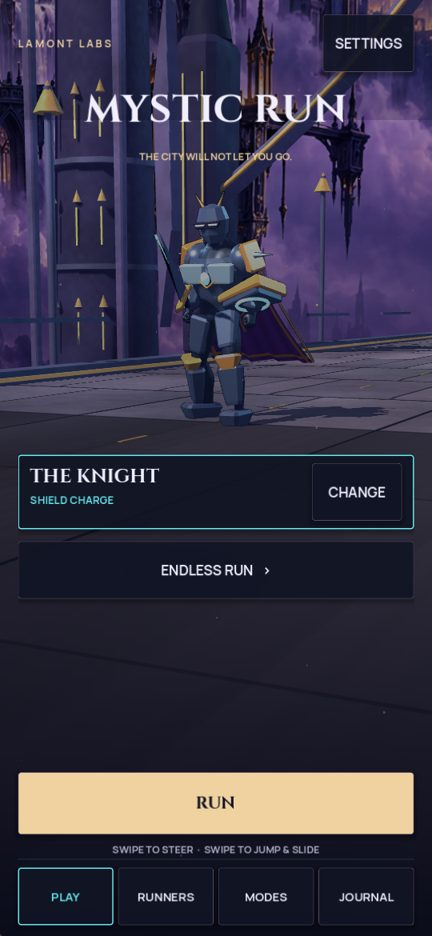
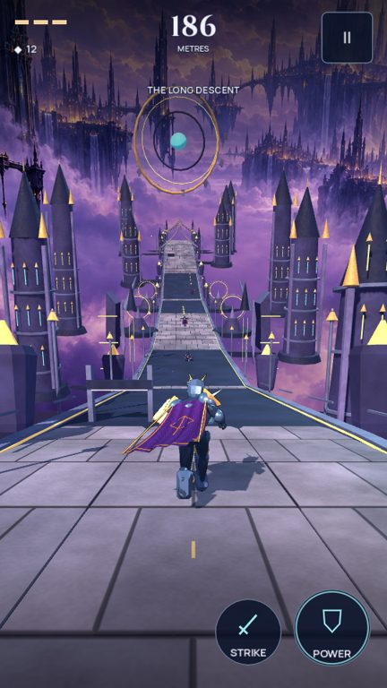
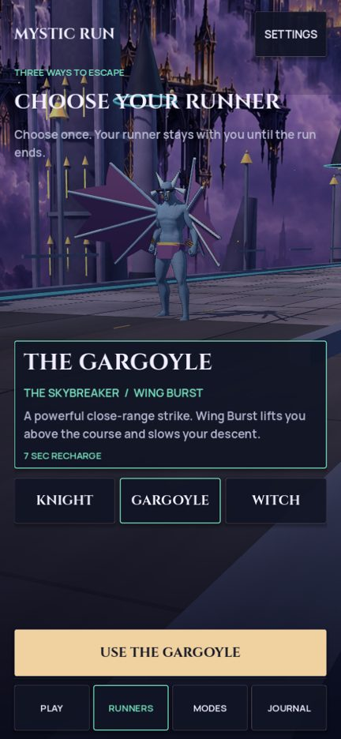

# Mystic Run 0.5.0 development status

November 2, 2026 · Lamont Labs

The next playable revision implements the November 2 UX research in the existing Godot Android game. The previous distribution baseline was signed build 0.4.0 / 1008. The new verified artifact is recorded below.

Implemented: direct opening-menu Run; the playable 3D character in menu/selection; runner selection returning to the same setup; Endless first for new profiles; protected integrated first-Endless lessons with retry/save progress and an honest skip state; preparatory enemy warnings and buffered active strikes; a smaller gameplay HUD; temporary district labels; visible power recharge; clearer results; and five authored architecture silhouettes per theme in the existing eleven-instance pool.

A rendering defect was corrected in the custom triangle builder: authored outward normals are retained while winding is reversed to Godot’s clockwise front-face convention. This exposes the intended armor and environment materials instead of their black outline pass.

## Verification

Local verification: **656 assertions passed** (427 core, 38 gesture/course, 138 native navigation/experience, 35 tilt/elevation and 18 animation). The navigation suite also passed all 138 checks with actual rendered GUI hit testing. Three 3,600-tick runs each covered about 1.31 km with zero damage, deaths, handoffs or off-screen runner-centre ticks. A separate rendered Knight run covered 603 m. Menu, roster, pause, results, expedition and fracture frames were inspected at 540 × 960 and 540 × 1170 desktop viewports. Exact Android provenance is recorded after compilation and signing. Automated tests and software-rendered desktop frames are evidence of implemented behavior. They do not establish Android sensor orientation, touch comfort, sustained frame pacing, thermals or owner approval of the premium visual target.

## Remaining quality work

The hero and scenery still use the existing base meshes plus procedural equipment and architecture. This revision improves their rendering, presentation and variety. It does not establish finished production character art or a premium visual-quality approval. The next art benchmark remains one polished hero, sentinel and coherent 60–90-second district judged from the chase camera in motion.

## Reviewed gameplay frames

## Verified Android artifact

- APK: `Mystic_Run_0.5.0_GitHub_Build1010.apk`; version 0.5.0 / 1010; arm64; 38,320,587 bytes.
- SHA-256: `72752b4a8f6b188c0cfc0507639a853e029c63c06c7acb5b9d36054915305f30`.
- Compilation source: `ef919ae421e80ddb4718fb009b0940996df6fd68`.
- [Successful GitHub compilation](https://github.com/Lamont-Labs/Mystic-Run/actions/runs/41539637667).
- All 94 runtime source and asset hashes in the compilation manifest match the local reviewed implementation.
- Preserved owner certificate, package/version, APK signature, ZIP integrity, unchanged packaged game payload, six notices, APK 16 KB alignment and native ELF 16 KB alignment verified.
- Signed-archive reconstruction was checked byte-for-byte; the publisher uses `.github/android-releases/build1010.json` to publish the exact signed artifact.
- Release tag: `v0.5.0-build1010`. The GitHub Release manifest and SHA256SUMS identify the published bytes.
- Physical Android installation, sensors, touch comfort, sustained performance and final art approval remain device/owner checks.
