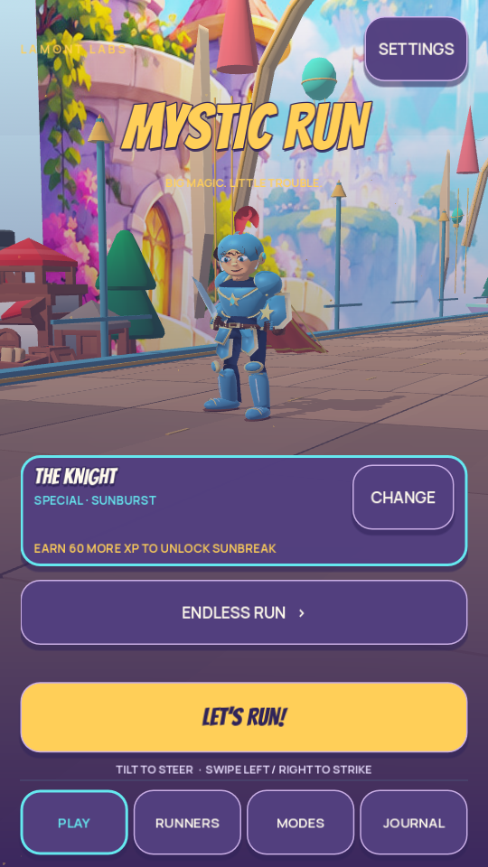
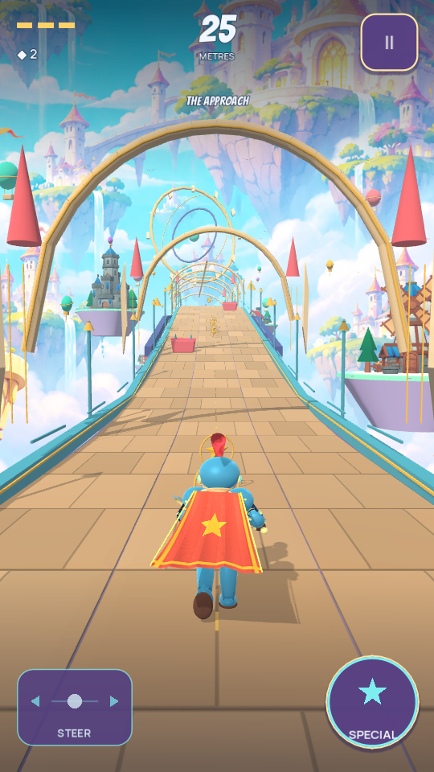

# MysticRun — first free-asset playable integration

Follow-up: [Knight geometry and expression refinement](KNIGHT_EXPRESSION_REFINEMENT.md) builds on this first milestone. The implementation and counts below describe the earlier environment/pipeline integration.

Lamont Labs · November 4, 2026
Development branch: `quality/free-asset-foundry`
Starting source: `e38e5a3eb27c996560f3e55251109833acd4569d` (published Knight build 1016)

This milestone implements a repeatable free-asset import path and a playable environment integration. It uses the publisher's free CC0 Medieval Hexagon Pack from Kay Lousberg / KayKit. It requires no new account, paid tool, asset subscription or gameplay network service. The character overhaul remains open: Knight retains the authored mesh from build 1016; Gargoyle and Witch retain their current models.

## Playable changes

Seven selected models—house, market, windmill, well, castle and two trees—are combined with custom floating platforms into four district compositions. Eight preallocated districts recycle along the route. Their elevation and lateral placement follow the existing course reference; no scenery collision bodies or encounter randomness were added.

The original windmill pivot is retained for cosmetic fan motion. Reduced Motion stops it, lower visual quality reduces visible districts, and secret chambers hide the outer scenery. Imported models share one 1024×1024 texture and one runtime material. The complete eight-district pool contains 35,054 source triangles, excluding the existing road, characters, effects, horizon and HUD. This is a source count, not a measured draw-call or phone-FPS claim.

The existing repeated procedural tower layer is replaced by these districts. The distant illustrated city, course geometry, encounters, core rules, three fixed-per-run characters, progression, save schema and Android signing identity remain as before.

## Actual Godot frames

These are actual Godot 4.7.2 Compatibility renders. They show the current imported models and existing character, rather than generated concept art.

| Opening screen | Chase-camera gameplay |
| --- | --- |
|  |  |

## Asset provenance and import

`assets/sources/kaykit-medieval.lock.json` pins the publisher repository to commit `84fa4e91af6a88989be7c99e0891cede11f2ca38`, the selected original glTF/buffer files, shared texture and included license. Every source file has an exact SHA-256 and byte count. Only the selected free models are imported; the paid EXTRA/SOURCE editions are not used.

`tools/asset_foundry.py` verifies the complete source selection before writing runtime assets. It preserves mesh topology, UVs and node hierarchy, flattens resource paths and adjusts material roughness/metallicity. Scene composition and animation are implemented separately in `game/asset_districts.gd`. Reimporting from the same pinned source produces byte-identical runtime files.

```bash
# Download only the selected pinned source files; no account required.
python3 tools/asset_foundry.py import-kaykit

# Or import from an existing checkout of the publisher repository.
python3 tools/asset_foundry.py import-kaykit --source-dir /path/to/KayKit-Medieval-Hexagon-Pack-1.0

# Offline verification of the runtime 3D inventory.
python3 tools/asset_foundry.py verify --report tests/evidence/asset-inventory.json
python3 -m unittest discover -s tools -p test_asset_foundry.py
```

`assets/asset_registry.json` also records the existing Quaternius body/hair sources, baked animations and authored Knight derivative. It verifies the complete inventory under the three model/scenery roots, local license evidence, exact bytes, declared permissions and glTF dependencies. Unknown, NC, ND, paid and unreviewed licenses are rejected by the current admission policy. `LicenseRef-LamontLabs-Original` is reserved for owner-authored art and does not relabel the retained CC0 rig or grant third-party rights.

The original publisher's license is retained under `assets/licenses/kaykit-medieval-CC0.txt` and shown in the game's Credits. Android export includes the notices and registry. `tools/build_android.py` runs asset verification before compilation and records its result in the build manifest. Gameplay CI runs the same inventory checks and imported-scene checks.

This inventory covers runtime 3D models, baked motion and the new scenery texture. Existing fonts, synthesized audio and generated illustrations retain their separate prior provenance records. Reviewed metadata and file hashes establish traceability; they are not a legal certification or Google Play approval.

## Verification

Local Godot 4.7.2 checks passed 813 assertions: 427 core, 38 controls, 125 adventure/progression, 148 scene/navigation, 35 tilt/elevation, 29 rig/motion and 11 new imported-scenery checks. The asset inventory passed 45 file/dependency checks across 24 runtime files. Ten new Python failure tests cover altered buffers, missing licenses, unknown/restricted licenses, false commercial permissions, unregistered assets, cyclic provenance, unsafe paths and remote glTF dependencies. Four existing Android-policy and six release-reconstruction tests passed.

Each of Knight, Gargoyle and Witch completed a 3,600-tick basic-only scripted run of 1,311.507 metres with zero damage, deaths, handoffs or off-screen runner-centre ticks. The new scenery suite also verified 24.6 km of recycling with fixed node count, finite transforms, actual transformed mesh bounds outside the seven-metre side corridor, shared materials, Reduced Motion, lower detail and secret-room visibility.

These are scripted desktop/headless checks. Physical-phone frame pacing, thermal behavior, touch comfort and the owner's final art approval remain unverified. This branch does not publish an installable Android release or replace the existing owner signing key.

## Next art milestone

Refine the Knight against the approved detailed cartoon concept, then author distinct Gargoyle and Witch bodies with the same import/provenance discipline. The free background models establish the production path; the heroes still need their own shape, face, costume and motion work.
