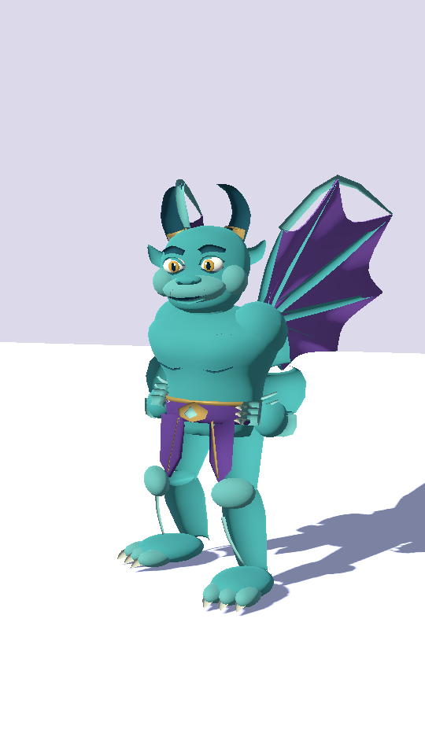
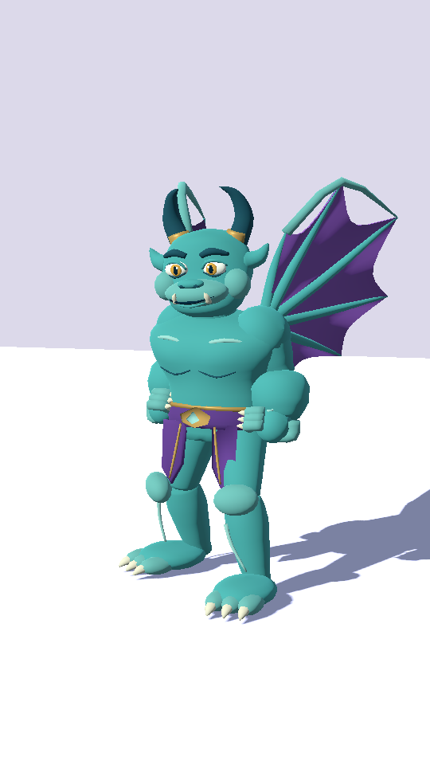
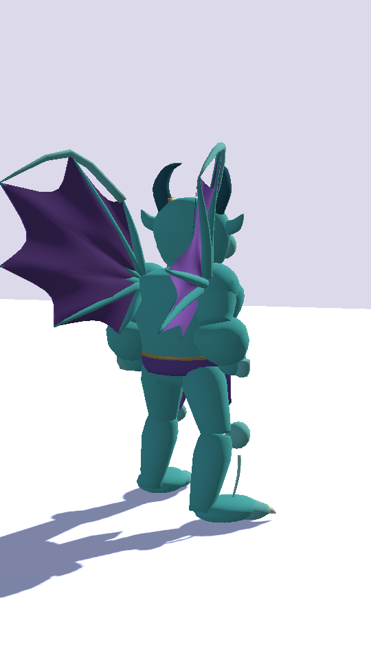
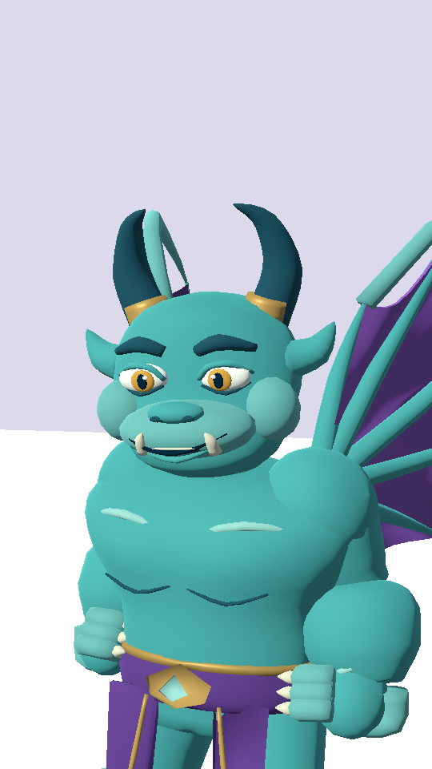
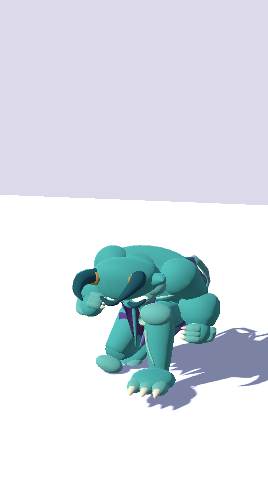
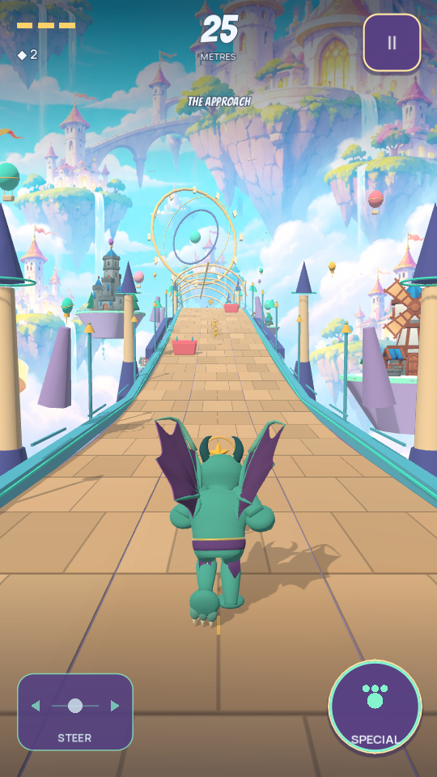

# Gargoyle exterior-surface refinement

Lamont Labs · November 4, 2026

This separate milestone follows the saved and green Witch checkpoint `dbbbb65100742c238e9b2055d88b6f6cb978c9d1`. The preceding Gargoyle replacement remains recorded at `2e4606d6ae24941d8d825408eb3a815d59621863` and in `AUTHORED_GARGOYLE_CHECKPOINT.md`.

## Correction

The curved-detail authoring helper previously emitted inward-facing tube side faces. This made parts of the brows, horns, claws, piping and wing spars appear hollow or disappear under back-face culling. The Gargoyle generator now opts into outward side faces, as the Witch generator already does. The source revision is `authored-gargoyle-2`.

The source point positions, weights, facial morph definitions, wing controls, palette and material shader are preserved. The complete model still has **22,722 source triangles**, **13,089 source vertices**, **69 bones**, **five facial morphs** and **one material surface**. The new GLB is **1,506,972 bytes**, SHA-256 `303d5e9a96638098a37a39a780c0f6b5ae7752fefa3127ffb6de2e8f703c957a`. A second build with Blender 4.3.2 produced identical bytes. Knight and Witch GLBs remain byte-identical to their saved versions.

## Actual engine comparison

| Earlier exterior curves | Corrected exterior curves |
| --- | --- |
|  |  |

| Rear | Face | Slide |
| --- | --- | --- |
|  |  |  |

Both stage views use the actual imported actor and the same fixed camera/lighting recipe. These are desktop development frames, not production art approval or phone-performance evidence.

## Regression evidence

The permanent imported-mesh test now samples exterior horn vertices away from the swept centreline and requires their normals to point outward. As a negative control, the previously saved GLB failed this exact check: **0 of 22** sampled normals pointed outward. The corrected GLB passed with **22 of 22**. This inspects actual exported geometry rather than accepting a metadata flag.

Local validation passed **863 Godot assertions**, **20 Python tests** and **49 inventory checks**. The full-creature slide maximum across the sampled contact interval remains **1.1857 m**, plus the existing conservative 0.014 m idle allowance, below the beam's **1.255 m** lower trim. Wing spans remain approximately 1.402 m running, 2.659 m airborne and 0.557 m sliding.

The corrected Gargoyle completed another 3,600-tick basic-only run of 1,311.507 m without damage, deaths, handoffs or off-screen runner-centre ticks. Knight and Witch retain their successful preceding runs and unchanged model bytes. `verification_gargoyle_surfaces.json` contains source hashes, the actual negative-control results, the latest model metadata and desktop-run evidence.

This is a focused surface correction. Material/texture finish, mobile LOD review, physical-phone testing and an owner-signed Android release remain open. No gameplay rule, collision shape, signing key, published release or Play listing changes here.
