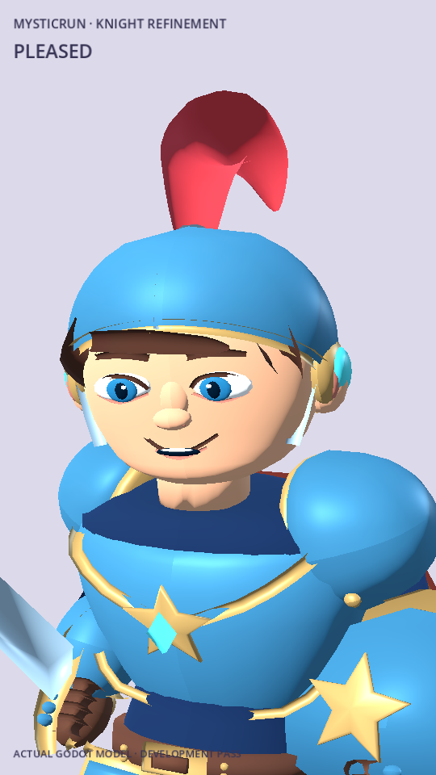
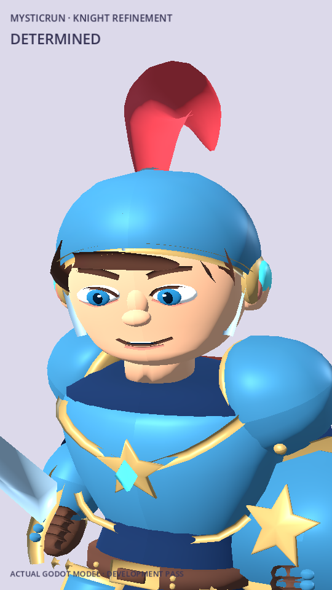
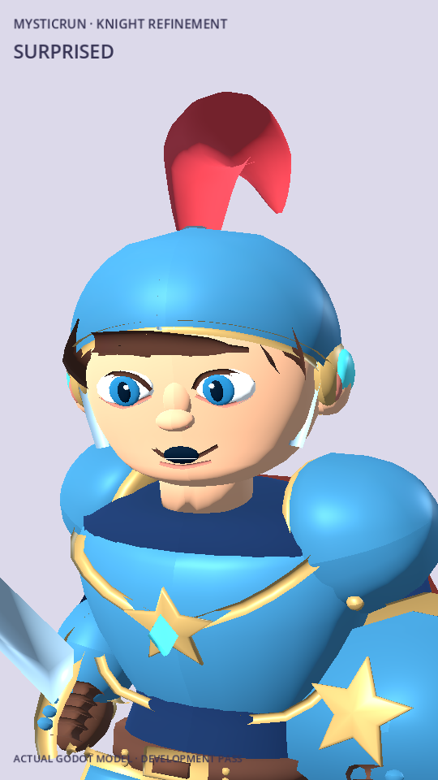
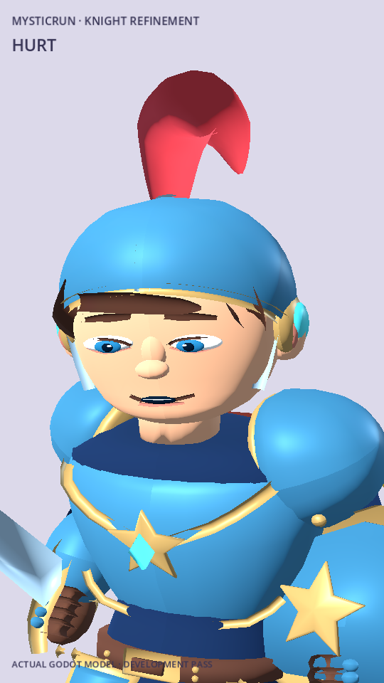
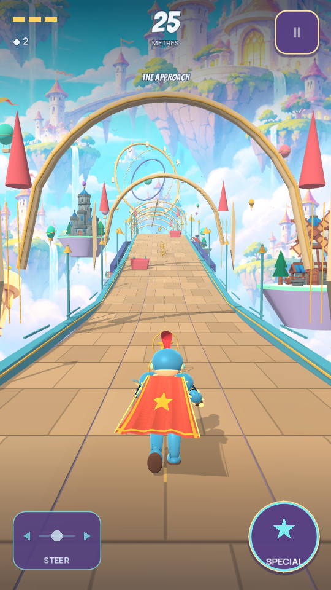

# Knight geometry and expression refinement

Lamont Labs · November 4, 2026

This development pass builds on the verified free-asset integration at `19105d494285ca760b753a3e675198eb63921249`. It refines the existing authored Knight and adds readable facial responses to the game's existing actions. It is a further art iteration; the full approved concept finish and independently shaped Gargoyle/Witch models remain open.

## Visible changes

- A smoother open helmet edge and a closed crown, replacing the previous open top ring.
- More contained temple hair, a single swept fringe, larger irises, smaller exposed eye whites, thinner brows and revised eyelids.
- A more rounded chin profile and a real inner mouth/teeth volume for expression changes.
- A corrected frame along generated curves: the plume, hair and curved trims no longer flip their cross-section when bending back. The plume also has closed ends.
- A cleaner character material that retains direct-light shape and painted gradients while suppressing the small self-shadows that obscured the face. The character still casts its ground shadow in the reviewed gameplay frame.

The six review states are neutral, alert, pleased, determined, surprised and hurt. Four new facial morphs—Smile, Focus, Surprised and Hurt—join the existing Blink and PlumeSway targets. The actual states follow existing run/jump, strike/special, celebration and accepted-damage events. They do not change combat timing, hit authority, movement, progression or save structure.

Blinking now uses the eye centre after the same head transformation as the source mesh. Expression weights are suppressed during eyelid closure so additive eye morphs cannot invert the eyes. Reduced Motion stops the decorative blink/plume movement while retaining the action expression. Player and sentinel expression weights remain independent.

## Actual engine frames

| Neutral | Pleased | Determined |
| --- | --- | --- |
|  |  |  |

| Surprised | Hurt | Actual gameplay |
| --- | --- | --- |
|  |  |  |

These are Godot 4.7.2 Compatibility renders. The close-up stage uses neutral lighting and Reduced Motion to make shape and expression comparisons clear. The gameplay frame uses the actual course, HUD, scenery and camera. The review video combines this stage with a short automatically controlled gameplay run.

## Asset and build evidence

The revised mesh has **24,328 triangles**, **14,498 source vertices**, **65 skeleton bones**, **one main material surface** and **six morph targets**. These counts exclude the separate cape/trim and import-generated LODs. The GLB is 1,662,012 bytes, SHA-256 `1be8296c2effc4c2a8b8b42ee529e8ca764dcf9af6923fc49ba6279c56c4bf23`. Rebuilding with Blender 4.3.2 produced byte-identical GLB output.

The existing Quaternius rig is retained under the explicit CC0 license included with the previously admitted free Standard pack. No new Quaternius download or site-wide licensing assumption is introduced. The Knight's original artwork record and exact runtime hash are updated by the generator without changing its rights classification or the rig's original license.

```bash
blender --background --python-exit-code 1 --python tools/build_knight_asset.py
python3 tools/asset_foundry.py verify
Godot_v4.7.2-stable_linux.x86_64 --headless --path . --editor --import --quit
Godot_v4.7.2-stable_linux.x86_64 --headless --path . --script res://tests/knight_expressions.gd
```

The existing Android compilation for the preceding free-asset commit passed in GitHub run `41920986759`; this follow-up must be compiled at its own commit before claiming an updated Android artifact. The development signing identity and release process are preserved.

## Verification and remaining work

Local checks passed **828 Godot assertions**: 427 core, 38 controls, 125 adventure/progression, 148 navigation, 35 tilt/elevation, 29 rig/motion, 11 scenery and 15 face/morph checks. Twenty Python tests and 45 asset inventory checks passed. The new tests inspect actual imported morph geometry, transformed eye closure, event priority, Reduced Motion and instance isolation.

All three characters completed their 3,600-tick basic-only runs of 1,311.507 metres with zero damage, deaths, character switches or off-screen runner-centre ticks. The short rendered gameplay review covered 148.193 metres with zero damage or switches. These are disclosed automated desktop checks, not human playability or Android performance measurements.

Remaining art work includes further costume/face polish against the concept, a painted texture atlas, character-specific motion and the Gargoyle/Witch replacements. Physical-phone frame pacing, thermal behavior, full visual slide clearance and touch comfort remain device checks. No Google Play production-readiness claim is made by this pass.
