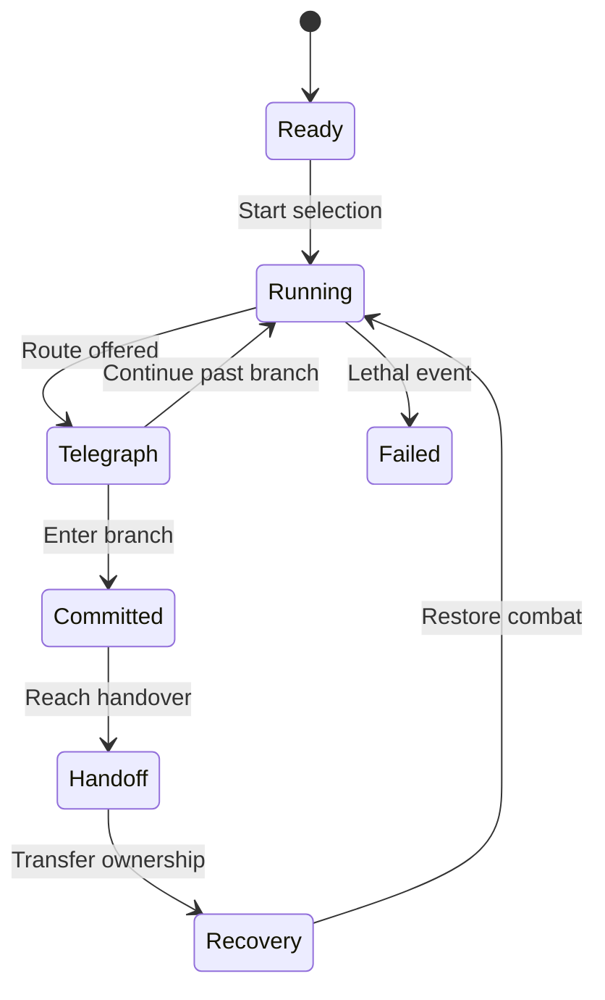
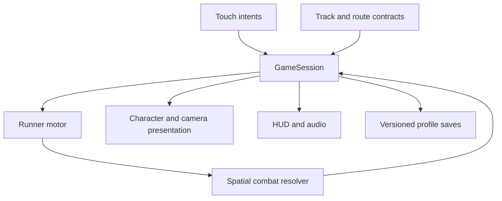

# Mystic Run — Master Android Game Development Blueprint

> Implementation update: the original headless foundation described below has become a playable Android alpha. `BUILD_STATUS.md` and the repository README provide current implementation and check results. This remains the design baseline; its original foundation-status entries are historical.

**Owner:** Lamont Labs / Jesse J. Lamont  
**Prepared:** October 30, 2026, America/Los_Angeles  
**Document version:** 0.1  
**Product identity:** Mystic Run, the owner's current working title.
**Current artifact:** Playable Android alpha plus the original technical design baseline.
**Distribution objective:** An Android game delivered as an installable, consistently signed APK for the owner's phone, with source and build evidence in a dedicated GitHub repository.

## 1. Product definition and decision authority

The game is a forward-moving 3D endless runner with combat, set in a world that combines dark fantasy and futuristic technology. The initial playable team consists of the Knight, Gargoyle and Witch. These are separate characters working together. The player chooses a starting character before play. During a run, choosing a designated route can automatically hand control to another teammate. The run continues through that handoff.

The product's central promise is that terrain, combat and character identity belong to the same decision: choosing a path determines both the challenge ahead and the teammate who handles it.

### 1.1 Confirmed by the owner

| Decision | Confirmed direction |
| --- | --- |
| Platform | Android app that can be downloaded, installed and used on the phone |
| Collaboration | Discuss and develop here; use GitHub for the project source |
| Game type | Endless runner |
| Presentation | Premium 3D, with forward motion preferred over side scrolling |
| World | A mixture of dark fantasy and futuristic elements |
| Initial roster | Knight, Gargoyle and Witch |
| Combat | Combat while running |
| Character changes | Starting/pre-level choice and/or a route choice that automatically changes the active character |
| Character identity | Separate teammates handing the run off to one another |

The recommendation in this blueprint is to support both starting selection and route-driven changes. The exact balance between those two mechanisms remains subject to playtesting.

### 1.2 Recommendations adopted for the engineering foundation

These are development defaults, not additional owner approvals of every detail.

| Area | Proposed baseline |
| --- | --- |
| Engine | Godot 4.7.2 standard editor with GDScript |
| View | Third-person camera behind and slightly above the active character |
| Directional movement | Three logical lanes or alignment anchors, visually integrated into organic paths |
| Input | Swipes for movement; consistent Attack and Power buttons |
| Team state | Shared run health, distance, score and collected run items |
| Individual state | Separate power cooldowns and character mastery |
| First environment | One cathedral district with ground, roof and rift route treatments |
| First mode | Endless run divided into recognizable districts and encounter sections |
| Early service model | Offline local play; no required account or custom backend |
| Orientation | Prototype portrait first; compare a landscape camera/input layout before locking production UI |

The relic, the city awakening, the teammates' motives and all working names beyond their three roles are creative proposals. The engineering architecture does not depend on accepting that story.

### 1.3 Actual build status

| Item | Status as delivered |
| --- | --- |
| Fixed-tick gameplay session rules | Implemented and executed in Godot |
| Route/handoff state model | Implemented and executed |
| Cooldown continuity, shared state, pause behavior | Implemented and executed |
| Attack tokens and reward uniqueness | Implemented and executed at the session-rule level |
| Static route safety contracts | Implemented; all three sample records pass |
| Gameplay-core checks | 412 assertions passed; includes repeated pair and pool-boundary assertions |
| GitHub core-check workflow | Written; not run in a remote repository |
| Playable 3D scene | Not implemented in this package |
| Production character/environment art | Not produced or imported |
| Spatial combat resolution | Not implemented; core checks are not physical hit detection |
| Android APK/export/signing | Not built or configured for this new game |
| Physical phone testing | Not performed |
| New GitHub repository | Not created, selected or modified |

## 2. The playable experience

### 2.1 Core loop

Select a starting teammate → enter the run → read terrain and enemy cues → dodge, jump, slide and attack → choose a route → hand control to its teammate when required → complete the section → collect rewards and continue into another district → eventually fail → review the run → restart or change the starting teammate.

The run has three overlapping forms of progress. Distance shows endurance. Encounters show moment-to-moment mastery. Routes show deliberate player choices. A high score should reward competent play across those systems without requiring every run to follow the same path.

### 2.2 First sixty seconds: an authored introduction

| Approximate time | Experience | Purpose |
| --- | --- | --- |
| 0–8 seconds | The selected teammate enters a broad cathedral approach | Establish camera, speed and basic steering |
| 8–18 seconds | One readable obstacle followed by one basic enemy | Teach that movement and combat coexist |
| 18–28 seconds | A simple jump/slide combination with a recovery stretch | Teach rhythm and input buffering |
| 28–38 seconds | A preview of ground, roof or rift directions | Introduce route identity |
| 38–45 seconds | Route commitment and a protected teammate handoff | Explain the game's defining mechanic |
| 45–60 seconds | A short encounter using the incoming teammate's strengths | Reward the route choice |

These times are authoring targets. The actual spatial layout and player speed determine the final timings. The opening should be repeatable for development, then shortened or skipped after the tutorial has been completed.

### 2.3 Endless structure with levels

A district is a recognizable level-like region inside the endless run. It has an introduction, a sequence of encounter chunks, an authored highlight and an exit. Finishing it changes the surroundings and encounter vocabulary while the run continues. Separate finite mission levels can be added later if they serve the same movement system, but are not required for the first mode.

Each district contains baseline routes plus character-focused branches. A player can retain the current teammate by staying on a compatible continuation or choose a signposted branch that hands control to another. Specialized branches must remain playable when a carried-over signature power is recharging.

### 2.4 Three layers of challenge

1. **Navigation:** Choose a traversable path and execute its movement requirements.
2. **Combat:** Read enemy intent and attack, evade or use a power at the right time.
3. **Route strategy:** Choose a teammate and challenge style suited to the next section.

Difficulty should add combinations gradually. Early runs introduce each layer separately before asking the player to handle all three at once. A route fork, enemy wind-up and low obstacle should not all demand a new decision at the same instant.

## 3. Characters: shared controls, distinct behavior

### 3.1 Knight

The Knight expresses mass, protection and commitment. The silhouette combines armor, a clear weapon shape and a readable supernatural power source. Run animation should show weight while remaining responsive to the player's inputs.

**Basic attack:** A forward sword sweep with target assistance. The initial implementation uses one reliable attack animation. A two-strike alternating sequence can follow once range, timing and hit reactions are verified.

**Signature power:** A shielded charge through explicitly breakable obstacles and suitable enemies. The powered period has a clear beginning and end. It does not silently protect against every kind of danger. Gaps, route edges and marked unbreakable structures retain their normal rules.

**Preferred sections:** Fortified streets, interior passages, ground formations and breakable machinery. A cooling-down charge always has a baseline route around the specialized obstacle.

**Animation emphasis:** Strong foot placement, controlled armor motion, readable shoulder preparation, forward impact and a clean return to the running cycle.

### 3.2 Gargoyle

The Gargoyle expresses verticality and controlled momentum. Wings are central to the silhouette but must fold cleanly during ground movement, sliding and tight passages. Mechanical reinforcement and weathered stone connect the creature to the setting.

**Basic attack:** A grounded claw strike. An airborne context may use a downward strike once its landing behavior is tested. The input stays in the same Attack position.

**Signature power:** A wing burst that extends an airborne section into a brief controlled glide. The route constrains the traversal; the first version does not require a general free-flight control system.

**Preferred sections:** Roof crossings, broken bridges, elevated enemies and broad aerial openings. An ordinary sequence of reachable platforms must exist when the power is unavailable.

**Animation emphasis:** Compact ground locomotion, powerful takeoff, wing deployment, stable glide, controlled landing and rapid wing folding before a low obstacle.

### 3.3 Witch

The Witch expresses precision, supernatural control and spatial opportunity. A strong body silhouette, restrained cloth motion and a focused casting device keep the character readable against effects-heavy environments.

**Basic attack:** Directed spell bolts toward a suitable enemy on the chosen route. Target assistance should prioritize the nearest valid threat in the intended travel corridor. It must respect line of sight, vulnerability and attack range.

**Signature power:** A short blink toward marked anchors. The destination is authored, shown before commitment and validated for clearance. The power cannot select an arbitrary unseen endpoint or place the runner inside a collider.

**Preferred sections:** Fractured platforms, magical defenses, moving mechanisms and marked anchor shortcuts. A physical continuation remains available when blink is cooling down.

**Animation emphasis:** Casting preparation that preserves movement, readable spell release, a compact disappearance/reappearance sequence, cloth control and precise foot placement after arrival.

### 3.4 Shared movement contract

The first playable uses one consistent gameplay capsule and shared baseline jump, dodge and slide rules. Art can extend beyond the capsule, but the camera, clearance envelope and track authoring must accommodate it. The Gargoyle's wings must not suggest that a visually clear path is actually blocked by a hidden collider.

Movement and character appearance are related without forcing the whole physics system to be replaced during a handoff. A canonical runner motor carries the active gameplay collision. Character rigs enter, attach at the ownership boundary, and leave as non-authoritative teammates. The fiction remains three separate individuals.

### 3.5 Initial tuning values

All numbers below are starting parameters for playtests. Only the values explicitly identified as implemented are current runtime behavior.

| Parameter | Starting value | Current status |
| --- | --- | --- |
| Logical simulation | 60 Hz | Implemented |
| Initial speed | 14 m/s | Implemented as a fixed speed |
| Later speed ceiling | 20 m/s | Content safety budget; acceleration not implemented |
| Basic attack interval | 0.40 seconds | Implemented as 24 ticks |
| Attack token validity envelope | 0.40 seconds | Implemented; spatial active window is still a scene responsibility |
| Knight power recharge | 8 seconds | Implemented as 480 ticks |
| Gargoyle power recharge | 7 seconds | Implemented as 420 ticks |
| Witch power recharge | 9 seconds | Implemented as 540 ticks |
| Shared health | 3 units | Implemented |
| Repeated-hit grace | 0.75 seconds | Implemented as 45 ticks |
| Lane change | Approximately 0.16–0.20 seconds | Proposed motor tuning |
| Jump input buffer | Approximately 0.10 seconds | Proposed motor tuning |
| Late-edge jump allowance | Approximately 0.10 seconds | Proposed; verify that visuals make the allowance understandable |

The session core does not yet model jump trajectories, lateral interpolation, attack animation timing or signature-power physics. A successful core call proves a rule was accepted, not that an animation or physical action occurred.

## 4. Route selection and teammate handoffs

### 4.1 Player-facing sequence

The player sees a destination character emblem and a terrain preview. Moving into its branch commits the route. The outgoing teammate reaches a clear handover area. The incoming teammate arrives at matching speed and direction. Control and collision ownership move at one defined boundary. A protected recovery segment establishes the new camera framing before the next threat.

The route signal combines icon, shape, animation and environmental treatment. Color alone is insufficient. Character-specific gates should be identifiable on a small screen and in reduced-effects mode.

### 4.2 State machine

Pause is a suspension of the current playable state, including Handoff and Recovery. Resume restores that exact state and its remaining logical time. A same-character branch continues without a staged handoff, immunity refresh or cooldown reset.

### 4.3 Ownership rules

1. One character owns player input, gameplay collision and combat at a time.
2. The outgoing actor becomes cosmetic before the incoming actor becomes authoritative.
3. Shared run state is not reconstructed from either rig. The session owns it continuously.
4. Handoff completion increments an ownership epoch once.
5. Attacks and enemy registrations from the outgoing epoch are retired at the protected handover boundary.
6. A repeated trigger cannot commit the same route twice or complete a second swap.
7. Incoming character assets and the next track section are ready before commitment can be offered.
8. Unexpected missing content falls back to a safe continuation before the player commits. It does not surprise the player with a different destination after commitment.

These are gameplay reliability rules. They do not make a client-side game tamper-proof.

### 4.4 Spatial safety contract

The sample metadata uses a 48 m preview, a 32 m protected corridor, and a first encounter at least 72 m after the handover origin. At the proposed maximum speed of 20 m/s, the preview provides 2.4 seconds. A 0.5-second handoff plus 1.0-second recovery consumes 30 m, leaving a margin inside the protected corridor. The first encounter then has at least 2 seconds of visibility after that corridor.

The validator independently requires at least 1.8 seconds of preview, enough corridor length for the complete protected interval, and at least 1.8 seconds of warning between corridor exit and the first encounter. All three sample route records meet these numeric conditions.

Static metadata cannot prove the player actually sees the route. The 3D validation gate must inspect sight lines, camera occlusion, elevation, effects, thumb coverage, actual speed and collider clearance.

### 4.5 Cooldown continuity

Powers retain their ready-at tick when a character leaves. Their recharge progresses in simulation time while another teammate runs. Pausing freezes that clock. Returning to a teammate does not grant an automatic fresh power.

This requires route authoring to provide a basic movement continuation when the incoming power is unavailable. A branch can offer an optional ability shortcut or reward, but the mandatory path must remain possible. Repeatedly choosing a same-character route cannot create extra invulnerability or recharge.

### 4.6 Handoff choreography matrix

| From | To | Proposed visual handover |
| --- | --- | --- |
| Knight | Gargoyle | Knight reaches an elevated break; Gargoyle sweeps into the route and takes over |
| Knight | Witch | Witch opens a parallel rift passage and emerges at matching speed |
| Gargoyle | Knight | Gargoyle descends toward a fortified landing where Knight takes the ground route |
| Gargoyle | Witch | Witch's rift appears beneath an arch as Gargoyle climbs away |
| Witch | Knight | Witch opens a sealed ground passage and Knight advances through it |
| Witch | Gargoyle | A rift exit opens beside an elevated flight corridor and Gargoyle takes over |

Same-character routes use continuation staging. Six directed pair handoffs need explicit choreography coverage; there are not merely three one-way transitions.

### 4.7 Inputs during a handoff

Directional intent may be buffered only if it can be applied safely after control returns. Attack and Power inputs are cleared at the ownership boundary and become available after recovery. A tap intended for the outgoing Knight must not unexpectedly cast a Witch spell after the camera changes.

The core currently blocks combat throughout Handoff and Recovery. The future input layer must also clear held buttons, cancel pointer captures on pause, and prevent a touch that began on a combat button from being reinterpreted as a route swipe.

## 5. Running combat

### 5.1 Encounter structure

Each encounter has an advance cue, a decision window, an attack or avoidance opportunity, a resolution and a recovery gap. The player should understand why a hit succeeded or failed. Each normal enemy encounter provides a legal solution using currently available actions; powers create advantageous alternatives.

The first two enemy types should test different decisions:

- **Armored guard:** A clear ground silhouette, a readable wind-up, and an attack that can be evaded or interrupted where the profile allows it.
- **Hovering security creature/machine:** A different height and projectile cue that tests movement, target selection and line of sight.

Elite variants can follow by changing timing and defensive states. Bosses should wait until ordinary encounters, camera behavior and damage feedback are dependable.

### 5.2 Physical hit resolution

Attack input creates a token associated with the current handoff epoch and a bounded validity period. The scene then evaluates the attack's actual active animation window, shape sweep or projectile, lane/corridor, range, line of sight and target vulnerability. A valid result resolves the registered enemy and awards its reward once.

The distinction matters: the delivered core verifies token timing and reward uniqueness. Its `resolve_enemy` function does not perform a 3D raycast or prove that the sword touched the enemy. That belongs to the future CombatResolver and its scene-level tests.

Enemy attacks use explicit phases such as wind-up, active threat, recovery and defeat. Defeat removes the gameplay threat before the visual death animation completes. Pooled actors must reset vulnerability, collision masks, animation state, particles and registration tokens before reuse.

### 5.3 Target assistance

Target assistance selects from valid candidates in the intended travel corridor. It should consider forward distance, lateral alignment, line of sight and enemy state. The closest threat in another route should not pull a Witch spell across an opaque wall or make the Knight turn away from the chosen path.

Assist strength is a tuning parameter. The player still decides when to attack and where to travel. A short target highlight can show the selected threat without covering its telegraph. The attack input should remain useful even when no candidate is valid: play an appropriate controlled animation without generating a false hit.

### 5.4 Damage and failure

Ordinary combat damage reduces the shared run health pool. A brief grace interval prevents one overlap or a cluster of callbacks from immediately consuming the entire pool. Damage feedback uses a readable character reaction, sound and optional restrained haptic cue.

A fall or explicitly fatal hazard may end the run immediately, but the level must clearly communicate its consequence. Combat hit reactions must preserve enough steering authority to avoid converting every recoverable hit into an unavoidable fall.

The first playable should not add paid revives or a complex healing economy. Its purpose is to establish understandable damage, satisfying recovery and a fast restart.

### 5.5 Scoring

Use separately inspectable components: distance, enemy rewards, clean encounters, optional route achievements and discovered collectibles. The first core implements distance and single-award enemy rewards. Combos and end-of-run aggregation are later work.

Comparing scores across characters requires measurement. A ranged attacker, a gliding character and an armored runner have different encounter opportunities. Early balancing should compare route reward rate, survival rate and encounter density rather than assuming equal cooldowns would make them equivalent.

## 6. Controls, camera and readability

### 6.1 Touch architecture

Use a normalized gesture field and two dedicated combat targets. Pointer identity matters: a swipe, a held Power contact and a second thumb's Attack tap must remain separate interactions. Start/end events must resolve even if the finger leaves a button's visual bounds.

Candidate gesture mapping is left/right for directional dodge, up for jump and down for slide. A short recognized gesture creates one intent, not repeated lane changes every rendered frame. Input buffering uses simulation ticks. Pausing, focus loss, app backgrounding and entering a menu clear held-state captures.

Touch targets should be comfortably thumb-sized on the reference phone and placed inside safe insets. Use a layout with adjustable button scale and left-handed mirroring once the core layout passes its first device test.

### 6.2 Camera rules

The camera follows a common route frame rather than each character's animated head or body height. That keeps the horizon and obstacle sight lines stable when the Gargoyle spreads its wings or the Witch hovers.

Use a consistent look-ahead point, damped lateral tracking and controlled vertical response. Character identity comes primarily from animation, effects and sound. Camera movement during an imminent obstacle must preserve its readability. Handoff framing can add spectacle inside the protected corridor and return to the same reliable gameplay framing.

Camera collision checks must avoid sudden push-ins that hide an obstacle. Occluding architecture should be authored around the travel view, with selective fading only where necessary and tested on-device. Any shake has a user control and a reduced-motion path.

### 6.3 Orientation decision

Portrait provides a tall forward view and familiar runner handling. Landscape provides wider combat visibility and more room for two-thumb controls. Both are plausible; neither has been confirmed by the owner.

Run an early comparison using the same course, speed, enemy positions and character assets. Record missed route cues, accidental swipes, thumb occlusion and comfort after several runs. Choose one production orientation before fully authoring menus and cinematics.

### 6.4 Accessibility baseline

Provide separate music and effects controls, reduced shake, reduced flashes, adjustable input sensitivity, visible alternatives to audio cues and symbols in addition to route colors. Preserve critical telegraphs when effects are reduced. A low-effects setting may simplify decoration but must retain hazard edges, target states and handoff identity.

## 7. World generation and authored content

### 7.1 Authored chunks assembled by rules

Build repeatable, authored track chunks rather than placing obstacles independently at random. A chunk declares its entry/exit frame, valid character states, speed range, required movement, safe continuation, route options and encounter budget. The generator selects compatible chunks and validates the transition between them.

This produces repeatable building blocks that an artist and level designer can inspect. Random selection changes the sequence, while encounter grammar preserves fairness.

### 7.2 Chunk vocabulary

| Chunk type | Purpose | First content target |
| --- | --- | --- |
| Recovery | Restore view and input rhythm | Two variations |
| Traversal | Jump, slide or directional decision | Four variations |
| Combat | One understandable enemy decision | Four variations |
| Mixed encounter | Combine already-learned movement and combat | Two variations |
| Branch preview | Show route destinations and upcoming terrain | One family with three character treatments |
| Handoff corridor | Transfer ownership safely | Six directed staging cases |
| Set piece | Deliver a memorable environmental event | One cathedral mechanism event |
| Rejoin | Return branches to a compatible route frame | One family |

These counts are a first content-production target, not content that currently exists. Several treatments can reuse geometry or animation while still requiring separate validation.

### 7.3 Traversability validation

Represent a chunk as time- or distance-indexed reachable states: lane, grounded/airborne posture, available baseline movement and remaining ability state. Validate that at least one path reaches the exit from every advertised supported entry state. Adjacent chunks must also be checked together: a jump at the end of one chunk cannot force an immediate impossible slide in the next.

Static validation catches impossible requirements early. A physics harness then runs representative input sequences against actual colliders. Finally, a person plays the physical-device build to check visibility, timing and feel. Passing one layer does not substitute for the others.

### 7.4 Speed and difficulty

Increase challenge through enemy combinations, timing variation, route decisions and encounter density. Keep a tested upper speed limit. Every preview, jump and ability requirement is validated at the applicable maximum speed, not only at the easier initial speed.

The director maintains a recovery budget. After a handoff or demanding encounter, it inserts breathing room before another new decision. Difficulty choices must be recorded with the run seed and content revision for diagnosis.

### 7.5 Long-run world stability

Maintain distance and segment indices as logical progress. Keep rendered geometry near a local origin and recycle chunks behind the camera. Coordinate rebasing must move relevant world objects and preserve camera continuity, projectile state and path sampling.

Object pools have explicit capacities. Pool exhaustion triggers a safe simpler content choice instead of an uncontrolled allocation spike. Actors remove their combat registrations and clear state when recycled. The diagnostic event history is a bounded ring; it cannot grow indefinitely during an endless run.

## 8. Runtime architecture

### 8.1 Recommended engine and renderer

Godot 4.7.2 standard with GDScript is the recommended starting stack. This choice favors a source-driven workflow, a runnable headless check suite, direct Android export and an engine licensing model that does not require a paid engine subscription. This is a project recommendation, not a claim that selecting an engine guarantees premium visual quality. See sources S1–S4 and S9.

The current foundation was executed with the official Godot 4.7.2 Linux editor. The engine archive was verified against its SHA-512 digest. Keep editor and export templates on the same exact version. Evaluate the Mobile renderer on the reference phone for the visual slice. Compatibility is a separate fallback profile that needs its own lighting and effects validation. Forward+ is not the proposed Android baseline.

Unity is a credible alternative if a selected production asset or required integration makes it substantially better for this game. Changing engines should happen before building the content pipeline. The first real-asset import and phone benchmark are therefore an early decision gate.

### 8.2 Responsibilities

| Component | Owns | Must not own |
| --- | --- | --- |
| GameSession / RunCore | Run phase, health, score, cooldown clock, active character, ownership epoch | Materials, camera shake, raw touch recognition |
| InputRouter | Pointer ownership, gestures, button intents, input buffering | Direct health changes or character swaps |
| RunnerMotor | Path-relative movement, jumping, sliding, physical collision | Scoring or route reward policy |
| TrackDirector | Chunk selection, compatibility checks, safe look-ahead, recycling | Unsignaled post-commit route changes |
| HandoffDirector | Incoming/outgoing staging and ownership-boundary request | Independent reconstruction of run state |
| CharacterPresentation | Rig, AnimationTree, character effects and audio hooks | Authoritative collision or reward mutation |
| CombatResolver | Spatial hit proof, attack windows, enemy vulnerability | Unchecked duplicate reward grants |
| CameraRig | Stable framing, look-ahead, occlusion response, controlled handoff framing | Character ability cooldowns |
| HUDPresenter | Read-only display of current session and accepted input controls | Direct session field mutation |
| SaveService | Profile schema, atomic writes, backup recovery, migrations | Claiming an unvalidated live world can resume |
| AudioDirector | Mix priorities, event cues, music transitions | Deciding that an enemy died |

### 8.3 Information flow

Only the session coordinates changes to shared gameplay state. Visual events observe accepted state transitions. An animation callback can request a spatial evaluation, but it does not directly grant health, score or ownership.

### 8.4 Fixed-step simulation and reproducibility

The delivered core uses a 60 Hz logical tick and integer distance with a retained fractional remainder. Pausing stops that tick. Handoff deadlines, attack validity and power recharge use the same clock, avoiding a mix of wall time, animation time and frame delta.

This supports reproducible session-rule checks. Full cross-device bit-identical Godot physics, rendering and animation are not promised. A future diagnostic replay records seed, content revision, engine version, accepted tick-indexed inputs and important state transitions. It must be labeled a diagnostic replay unless actual world-state replay has been validated.

### 8.5 Data and versioning

Use typed Godot resources or validated content records for character tuning, enemy profiles, route definitions, chunk connectors, effects mappings and reward tables. Avoid embedding balance changes in unrelated scene scripts.

Every diagnostic run should identify the application build, source commit, engine, content revision, starting character, seed and settings profile. An asset/content update can change available routes even when the source code is unchanged; content identity belongs in the evidence.

### 8.6 Future scene composition

A production gameplay scene would contain the session coordinator, runner motor, camera rig, pooled chunk root, pooled enemy root, handoff staging root, effects pools, audio director and CanvasLayer UI. All three hero rigs are loaded before the first route that can require them. Background teammate staging uses simplified or inactive collision and bounded visual cost.

The delivered package intentionally contains the independently testable core and content contracts before these scene integrations. No empty gameplay scene is represented as a completed app.

## 9. Premium art and animation production

### 9.1 Unified direction

The proposed material language combines dark stone, aged metal, restrained luminous energy and supernatural surfaces. Advanced mechanisms should look integrated into the architecture. Each district gets a controlled accent family while the silhouettes and hazard language remain consistent.

Premium presentation depends on modeled forms, coherent materials, authored lighting, convincing motion, sound and stable performance. A single impressive still image is not evidence that the game looks or plays well in motion.

### 9.2 Asset workflow

Establish a source-art directory separate from runtime imports. Retain editable modeling files, animation source where available, baked textures, export presets and the runtime glTF/GLB outputs. Godot supports a structured import workflow for 3D scenes and animations; see S10 and S11.

Before approving a character asset, check proportion, silhouette at gameplay distance, skeleton structure, animation compatibility, weapon/hand sockets, mobile material cost, texture resolution, transparency, LOD behavior and commercial redistribution rights. A purchased visual asset and its animation license may have different conditions.

Image generation can help establish concept art, texture ideas and visual targets. It does not by itself supply a clean production mesh, reliable topology, deformation weights, animation clips or tested mobile materials.

### 9.3 Character asset contract

Each of the three characters needs a stable coordinate convention, consistent scale, documented forward axis, named skeleton, named attachment points, defined gameplay bounds, exported materials and a verified animation set. Art changes must not silently alter the collision capsule or movement tuning.

Required base clips per character: idle, run, dodge left, dodge right, jump start, jump air, land, slide enter, slide loop, slide exit, attack, power, hit reaction, defeat, handoff enter and handoff exit. That is 16 clips per hero, or 48 across the trio, before character-specific extras. A Gargoyle glide loop and dive strike plus a Knight charge loop bring the initial planning inventory to approximately 51 hero clips. Some may be retargeted or shared where appropriate; each still requires verification on its target rig.

The six directed handoff cases require stage choreography and camera validation. They do not necessarily require six entirely separate full-body animation sets; controlled reuse of entry/exit clips can reduce production cost.

### 9.4 Animation authority

Use AnimationTree for transitions and layered presentation. Keep accepted movement driven by the motor. Root motion may inform visual alignment or a carefully bounded action, but the locomotion animation must not independently advance the authoritative runner while the motor also moves it. Godot documents its animation blending and root-motion facilities in S10.

Weapon trails and particles follow the accepted active window. An elaborate anticipation animation should not add an unexplained input delay. When a hit reaction blends over a run, the legs and path movement must remain coherent.

### 9.5 Environment kit

The cathedral district should start with a reusable architectural kit: floor sections, walls, arches, columns, roof edges, bridges, railings, machinery housings, gates and several landmark pieces. Modular geometry must hide repetition through composition, elevation, dressing and lighting without compromising route readability.

Build collision deliberately. Small decorative protrusions should not snag the gameplay capsule. Invisible barriers should not contradict the apparent path. A large moving machine may have simplified gameplay collision with a separately staged visual mechanism, provided the two remain perceptually aligned.

### 9.6 Visual acceptance

Record moving gameplay on the reference phone. Review character silhouette, foot contact, slide clearance, wing folding, spell readability, material consistency, lighting at route entrances, handoff framing and enemy cues under worst-case effects. Inspect frames from actual play, not only editor beauty shots.

Art approval requires a short recorded run through the busiest validated encounter, at the intended quality profile, with frame-time evidence. A visual sign-off and a performance sign-off should refer to the same build.

## 10. Audio and tactile feedback

Use a mix that communicates gameplay first. Enemy wind-ups, successful hits, damage, power readiness and route/handoff cues must remain distinguishable under the music. Music can evolve between districts and characters without drowning the next obstacle cue.

The proposed palette combines mechanical percussion, atmospheric voices, low-frequency machinery and distinct character materials. Knight impacts should have weight, Gargoyle movement should communicate stone and wing force, and Witch effects should have a focused supernatural identity.

Haptics should be brief, optional and event-based. Basic continuous footsteps do not need constant vibration. Large handoffs and heavy impacts can receive stronger feedback, with the reduced-feedback setting preserving essential visual/audio information.

## 11. Menus, progression and persistence

### 11.1 First screen inventory

| Screen | Required purpose |
| --- | --- |
| Title / home | Start quickly, show selected teammate and reach settings |
| Character selection | Explain the three roles and select the starting teammate |
| Gameplay HUD | Health, score/distance, power state, route identity and pause |
| Pause | Resume, restart, settings and exit to home |
| Results | Explain distance, rewards and important accomplishments; allow immediate restart |
| Settings | Audio, visual quality, frame target, effects/motion, sensitivity and control layout |
| Credits / licenses | Game authorship and required engine/asset notices |

Avoid adding account onboarding or a store before the owner can install and enjoy the core game. Critical HUD elements stay out of the forward route-reading area and inside device safe insets.

### 11.2 Progression philosophy

Unlock knowledge, challenges, cosmetic expression and character mastery before adding large statistical advantages. The first playable can expose all three core characters so the defining team mechanic is testable immediately.

If future upgrades change recharge, health or movement, the generator must validate routes against the actual loadout. A score category may need to record upgrade state. Persistent progression should not silently invalidate encounter tuning.

### 11.3 Save model

Versioned local profile data includes settings, tutorial completion, unlocked cosmetics, mastery records, personal bests and last-completed-run metadata. Use a temporary write, validation, atomic replacement and a recoverable previous copy. Test a corrupted current file and an interrupted write.

Live-run resume is a separate feature. It needs a safe checkpoint containing content revision, chunk cursor, generator state, character, health, score, cooldowns and relevant world state. The delivered core has no world checkpoint implementation. Suspending and restoring an arbitrary airborne frame is not a requirement for the first playable.

When the app backgrounds, pause immediately, clear touch captures and save stable profile changes. Resume through an explicit ready/countdown state so a returning player is not thrown into an unseen attack. Wall-clock time should not finish a handoff or recharge powers while the simulation is suspended unless a later product decision explicitly changes that rule.

## 12. Mobile performance and quality profiles

### 12.1 Performance is a measured product requirement

The first reference device is the owner's actual phone. Record its model, GPU, Android version and refresh-rate settings during the first install test. Do not infer supported performance from screen resolution or a model name alone.

Android's performance guidance emphasizes measuring scenes, distinguishing CPU/GPU bottlenecks, checking frame pacing and testing thermal behavior. See S6–S8. The numbers below are proposed engineering budgets; none has been measured for this game yet.

| Metric | Initial acceptance target |
| --- | --- |
| Primary frame target | 60 FPS where the reference phone sustains it |
| Reduced-cost profile | A stable 30 FPS profile with preserved controls and telegraphs |
| Sustained test | At least 20 minutes across repeated demanding sections |
| 60 FPS frame pacing | Aim for p95 at or below 20 ms and p99 at or below 33.3 ms in the defined stress run |
| Severe hitches | Investigate every repeatable gameplay frame above 50 ms |
| Peak process memory | Initial budget below 800 MB for the vertical slice; measure actual PSS/RSS consistently |
| Runtime texture budget | Start near 128 MB for the reduced profile and 256 MB for the higher profile |
| Cold startup | Initial goal under 8 seconds to an interactive menu |
| Cached restart | Initial goal under 2 seconds from results to a ready run |
| Source of evidence | On-device non-editor build, with settings, build ID and test route recorded |

Frame-time percentiles must be reported with the capture method and test duration. A short, cool-device run does not establish sustained performance.

### 12.2 Starting content budgets

Begin with approximately 15–25k triangles for the active hero's highest gameplay LOD, lower-cost visible teammates, pooled enemies, reused materials and a carefully bounded visible environment. These are provisional content budgets, not device capability claims.

Use baked or inexpensive environment lighting where possible, a restrained number of shadowed lights, pooled effects and explicit transparency limits. Wing membranes, spell effects, fog cards and full-screen overlays can create overdraw even when mesh counts look modest.

LOD changes, mesh simplification and texture compression should preserve the forms that communicate a hazard. The low-quality profile should simplify decoration before it removes the information needed to play fairly.

### 12.3 Thermal strategy

Collect frame-time and thermal observations during a sustained session. If performance degrades, reduce controllable rendering costs before changing gameplay timing. Maintain the fixed simulation rules. A graphics-quality transition must not shorten route warning time or alter enemy wind-ups.

Adaptive thermal integration requires an engine or Android bridge implementation and verification; no such plugin is included in the current source. First establish manual quality profiles and measured sustained performance.

### 12.4 Memory and loading

Preload the three required hero rigs, their essential effects and the next safe route before offering a branch. Stream or load future sections early enough to avoid blocking the main thread at the commitment point. Pool common enemies, attack effects and route props.

Track long-run memory after repeated pool reuse, restarts, menu transitions and pause/resume. A single scene load that succeeds does not prove memory remains bounded across an endless session.

## 13. Android packaging, signing and GitHub delivery

### 13.1 Build contract

Pin the editor version, matching export templates, Android export configuration, SDK tool versions, content revision and build script. Godot's versioned Android export documentation describes JDK 17 and the SDK configuration; see S3. Use the exact engine-version documentation rather than copying requirements from an unrelated release.

For owner testing, produce an arm64 APK first after confirming the reference phone's ABI. Add x86_64 only where needed for an emulator validation profile. The public application title and final package identifier remain undecided. A stable development application ID should be selected before repeated owner installs, because changing it creates a separate app and save location.

### 13.2 Signing identity

Android requires signed APKs. Updates must use an installation-compatible identity and signing lineage. See S5. Generate an owner-controlled development signing identity once, keep a protected backup and use it consistently for the development package. A fresh ephemeral CI key for every build is unsuitable for a smooth update workflow.

Keep private signing material out of the source repository and deliverable ZIP. Store CI credentials in repository or environment secrets once the owner provides that configuration. The existing GitHub tools do not establish secret-management permissions. Repository content-write access also does not prove workflow-write permission.

For a future public release, select the production application ID and signing strategy deliberately. An AAB is a store-distribution artifact, while an APK is the direct-install deliverable discussed here. Future Play publication must recheck then-current store requirements instead of assuming today's development target is sufficient.

### 13.3 Two different workflow milestones

**Current workflow:** Checkout → install checksum-pinned Godot editor → run core checks → preserve JSON evidence. It requires no Android signing material and produces no APK.

**Future Android workflow:** Checkout exact commit → verify toolchain → import assets → parse scripts → run core and scene checks → validate content/license inventory → export using matching Android templates → sign with the established development key → verify signature and package metadata → calculate checksum → attach APK plus build manifest and test report.

The Android workflow should fail if the gameplay main scene is missing, export produces no APK, the signer differs from the expected development certificate, the package ID changes unexpectedly, or the version code is not valid for the intended update. It must not upload an empty or stale build file and report success.

### 13.4 Build provenance

Each APK is accompanied by its SHA-256, source commit, content revision, engine version, application ID, version code, signing-certificate fingerprint, export profile and test results. A reproducible source recipe does not imply byte-for-byte identical APKs; signing and archive metadata can affect bytes. Claims of reproducible binaries require their own comparison procedure.

The APK filename should include a human-readable development version and short source revision. GitHub Actions artifacts can preserve build output and reports, subject to repository retention settings; see S4. For convenient distribution, a later release asset can provide a durable download once the owner authorizes that publishing step.

### 13.5 GitHub organization

Use a dedicated repository after its destination is selected. Keep the main branch buildable, implement changes on bounded branches, and describe the problem, resulting behavior and actual validation in each pull request. Binary source art may need Git LFS or a separate documented art store once actual asset sizes are known; that decision must account for the account's quotas.

The current connection has demonstrated access to existing Lamont-Labs repositories. It has not demonstrated creation of a repository for this game, successful workflow-file writes, secret configuration or a successful Android workflow. These are concrete integration checks rather than assumptions.

## 14. Verification strategy

### 14.1 Evidence layers

| Layer | What it establishes | What it does not establish |
| --- | --- | --- |
| Core assertions | State transitions, timer behavior, ownership and reward rules | Camera, collider or touch correctness |
| Static content checks | Declared route timing and supported requirements | Actual visibility or physical reachability |
| Scene integration checks | Movement, hit shapes, pooled state and marker behavior | Comfort and sustained device quality |
| APK verification | Export, signature, package, architecture and installability | Gameplay quality or long-run performance |
| Physical-device play | Actual controls, readability, motion, heat and interruptions | Correctness on every Android device |
| Production review | Art consistency, licensing, audio, polish and complete player flow | A guarantee of commercial success |

### 14.2 Required core cases

The delivered checks cover the three valid starting characters; rejection of an unselected character; preservation of state through a handoff; commitment idempotency; protected transition phases; cooldown continuity; same-character continuation; optional branch bypass; pause inside a handoff; stale and expired attacks; duplicate enemy rewards; damage grace; lethal failure; all nine source/target combinations; tick-batching consistency; fractional-distance retention; bounded event history; and a live encounter capacity boundary.

The total is 412 assertions, including repeated checks across combinations and pool entries. It is not 412 separately authored gameplay scenarios. The evidence JSON records the exact engine and SHA-256 hashes of the tested source files.

### 14.3 Required scene cases

- Every advertised jump and slide works at minimum and maximum validated speed.
- A lane change started near a chunk seam preserves position and collision.
- A held attack cannot fire again under a new character after a handoff.
- Each of the six directed handoffs works while the prior power is cooling down.
- Outgoing projectiles, attack windows and pooled registrations cannot hit or reward after retirement.
- A same-character branch does not grant transition protection.
- A Witch destination is clear before commitment and remains clear through arrival.
- A Gargoyle lands on valid ground with wings and collision state correctly restored.
- A Knight charge ends before an incompatible hazard and gives a readable recovery.
- The busiest effects case preserves enemy and route cues.
- A missing or late future chunk triggers a safe pre-commit fallback.

### 14.4 Required Android cases

Install on the reference phone; launch offline; start with each character; complete a route handoff; attack and take damage; fail and restart; pause; background and resume; receive an interruption; lock/unlock the device; test low-battery behavior; run the sustained stress session; terminate and relaunch; upgrade over the previous signed build; verify settings and records survive; inspect a corrupted-save fallback.

Record actual outcomes. Installation success must not be reported as completion of all those cases. Keep a concise owner-readable status report linked to the tested APK and build identity.

## 15. First playable scope and milestone gates

### M0 — Engineering foundation

**Delivered here:** Session core, static route contracts, content records, executable Godot checks, a source-bound evidence report, and a core-check CI definition.

**Passed:** The local Godot execution returned 412 checks and zero failures.

**Open:** Remote repository workflow execution and every scene/device gate.

### M1 — Install and movement proof

Create the canonical runner motor, a real path section, camera rig, touch router, pause behavior and a minimal Android export configuration. Include the selected development signing identity. Produce an APK, install it on the reference phone and compare portrait/landscape control framing. This milestone establishes an executable device pipeline and baseline movement; it is not the premium visual acceptance gate.

### M2 — Production visual slice

Import a production-quality Knight, an initial environment kit and the essential animation set. Establish lighting, material budgets, camera framing and an actual on-phone performance baseline. Approve the moving visual target before duplicating the pipeline for the remaining two heroes.

### M3 — Running combat

Implement basic attacks, spatial hit proof, one guard type, one alternate threat, damage feedback, single-award reward resolution and fast restart. Verify attack cues and input timing on the reference phone.

### M4 — Three-character relay

Import Gargoyle and Witch, implement their powers, stage all six directed handoffs, expose starting selection and offer the three route treatments inside one coherent district. Verify cooldown carryover, same-character continuation and recovery safety in the real scene.

### M5 — Endless assembly

Author the initial chunk library, build compatible seeded selection, validate connector reachability, pool assets and recycle world geometry. Run long sessions across repeated route changes and restarts.

### M6 — Owner alpha

Complete profile persistence, settings, results, accessibility controls, quality profiles, interruption handling, update testing and sustained performance review. Deliver the consistently signed APK and its build evidence.

### M7 — Premium expansion

Add further districts, richer character mastery, additional encounter variations, stronger set pieces and team story beats. Expand only after the first district's movement, combat and handoffs meet their evidence gates.

## 16. Effort, costs and practical constraints

The engine is available under the MIT license, but engine choice does not eliminate costs for asset production, animation, audio, build compute or eventual distribution. No purchases, paid services or external publishing actions have been made for this game.

The largest unknown is production content. Three distinctive hero bodies, wing behavior, spell animation, weapon contact, six handoff cases and a polished environment create a meaningful art/animation workload. AI-assisted code generation can accelerate implementation, while the final motion, asset rights, import quality and device validation still require inspection.

Use milestone estimates after M1 and M2, when the toolchain, target device and asset pipeline have been proven. A credible full premium game is a multi-stage project; a finished launch date should not be invented from the speed of writing the first scripts. For short founder work windows, each development session should leave a bounded commit, a check result and a clear next task.

### 16.1 Spend decisions

| Category | Current requirement | Decision rule |
| --- | --- | --- |
| Engine | Godot standard editor and matching templates | Pin and verify; retain license notices |
| Backend hosting | Not required by the proposed first game mode | Add only for a specific accepted feature |
| Build compute | Local checks now; GitHub runner later | Verify account quotas before relying on frequent cloud builds |
| Hero/environment assets | Production source still needed | Choose by style, rig compatibility, mobile cost and rights |
| Audio/music | Source still needed | Secure redistribution rights and coherent sound direction |
| Signing backup | Required before repeat owner APK updates | Keep owner-controlled protected copies |
| Public store | Later product decision | Recheck then-current account and platform requirements |

### 16.2 Material risks and mitigations

| Risk | Visible consequence | Mitigation / evidence |
| --- | --- | --- |
| Premium concept without production assets | Code works but visual bar is missed | Approve a moving real-asset slice at M2 |
| Handoff camera disruption | Player misses the next threat | Stable route frame, protected corridor, device recording |
| Power-dependent unavoidable route | Unfair failure after switching | Baseline bypass and cooldown-aware validation |
| Input conflict under two thumbs | Accidental lane changes or missed attacks | Pointer ownership tests and orientation comparison |
| Duplicate/stale collision callbacks | Incorrect damage or rewards | Token/epoch rules plus scene-level retirement tests |
| Thermal slowdown | Good first minute, poor sustained play | Defined 20-minute capture and quality profiles |
| Repeated-key signing mismatch | Update cannot install over prior build | Persistent signing identity and certificate check |
| Unlicensed or incompatible assets | Rework or blocked distribution | Asset inventory and import/license review before integration |
| Endless-session resource growth | Hitches, memory pressure or crash | Pool caps, bounded logs and long-run memory captures |

## 17. Source package and handoff requirements

The package contains source, content metadata, checks, tooling and documents. It does not contain a game binary or signing secrets. Its README explains the exact execution command and current scope. The included verification JSON binds results to tested files.

Before a future developer or partner receives a complete game handoff, add the dedicated repository URL, version history, build instructions, APK manifest, signing ownership process, asset/license inventory, editable source-art locations, phone test report, known issue register and a short recorded gameplay walkthrough.

A handoff-ready claim requires another developer to reproduce the intended build using the documented toolchain and owner-provided credentials where necessary. A demo-ready claim requires the actual APK to complete the agreed player flow on the target phone. The current package makes neither finished-game claim.

## 18. Open decisions in execution order

1. Select or create the dedicated repository and establish workflow write access.
2. Choose a stable internal application ID and owner-controlled development signing process before repeat device installs.
3. Record the reference phone and prove an Android export/install path.
4. Compare portrait and landscape using the same short course and lock the production orientation.
5. Approve the trio's production visual design and asset sourcing path.
6. Approve or replace the relic/city story proposal.
7. Select a public game title after checking relevant naming constraints when publication becomes concrete.
8. Decide later progression, monetization and public distribution after the core experience is demonstrated.

These decisions do not block the delivered core foundation. They should be resolved when they first affect concrete implementation, without repeatedly reopening the owner's confirmed roster, handoff identity or world direction.

## 19. Primary technical sources

Sources were consulted on October 30, 2026. Product mechanics, numerical budgets and milestone proposals are original project design recommendations; source citations establish engine/platform facts, not that this unbuilt game already meets its targets.

- **S1 — Official Godot 4.7.2 release:** [Godot download archive](https://godotengine.org/download/archive/4.7.2-stable/).
- **S2 — Renderer selection:** [Godot overview of renderers](https://docs.godotengine.org/en/stable/tutorials/rendering/renderers.html).
- **S3 — Versioned Android export:** [Exporting for Android, Godot 4.7](https://docs.godotengine.org/en/4.7/tutorials/export/exporting_for_android.html).
- **S4 — GitHub build artifacts:** [Store and share data with workflow artifacts](https://docs.github.com/en/actions/tutorials/store-and-share-data).
- **S5 — Android signing:** [Sign your app](https://developer.android.com/studio/publish/app-signing).
- **S6 — Mobile performance method:** [Analyze and optimize game performance](https://developer.android.com/games/optimize/gameperformance).
- **S7 — Frame pacing and slow sessions:** [Android slow sessions](https://developer.android.com/topic/performance/issues/slow-session).
- **S8 — Thermal and power considerations:** [Optimize power efficiency](https://developer.android.com/games/optimize/power).
- **S9 — Engine license:** [Godot license](https://godotengine.org/license/).
- **S10 — Animation:** [Using AnimationTree](https://docs.godotengine.org/en/stable/tutorials/animation/animation_tree.html).
- **S11 — Asset import:** [Importing 3D scenes](https://docs.godotengine.org/en/stable/tutorials/assets_pipeline/importing_3d_scenes/index.html).
- **S12 — Command-line execution/export:** [Godot command-line tutorial](https://docs.godotengine.org/en/stable/tutorials/editor/command_line_tutorial.html).

## 20. Development-session acceptance record

A completed work session should identify the intended behavior, changed source/content, actual checks, remaining limitations and next bounded task. Preserve the tested source revision and build identity. Avoid promoting a documentation target into an implemented feature until its evidence gate is satisfied.

The first such record is the delivered core execution: official Godot 4.7.2, 412 assertions, zero failures, source hashes in `verification_actual.json`, no Android build and no phone test. That gives the next session a concrete starting point.
