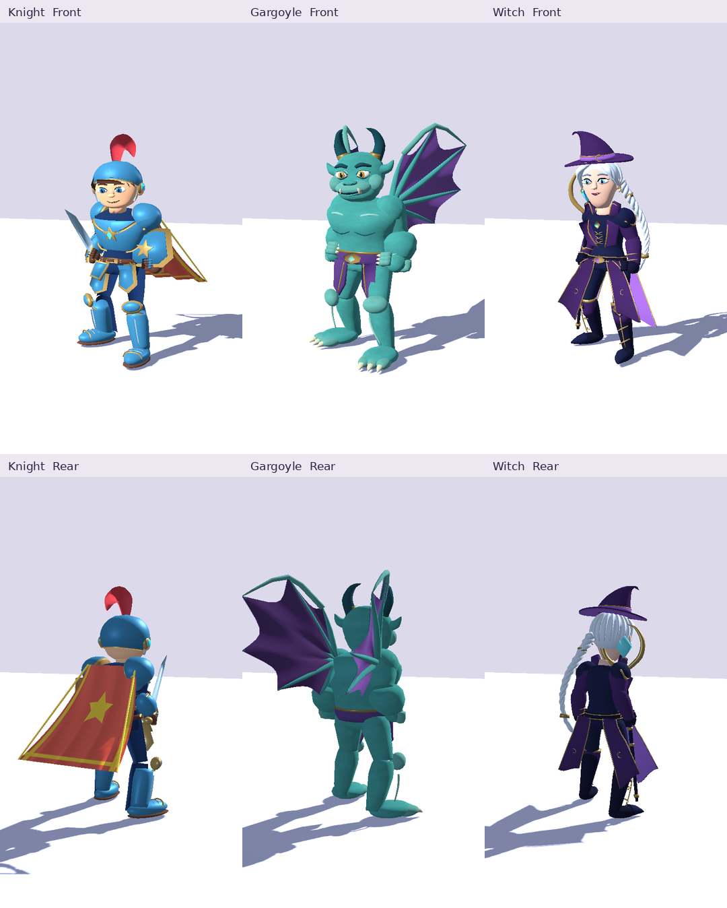
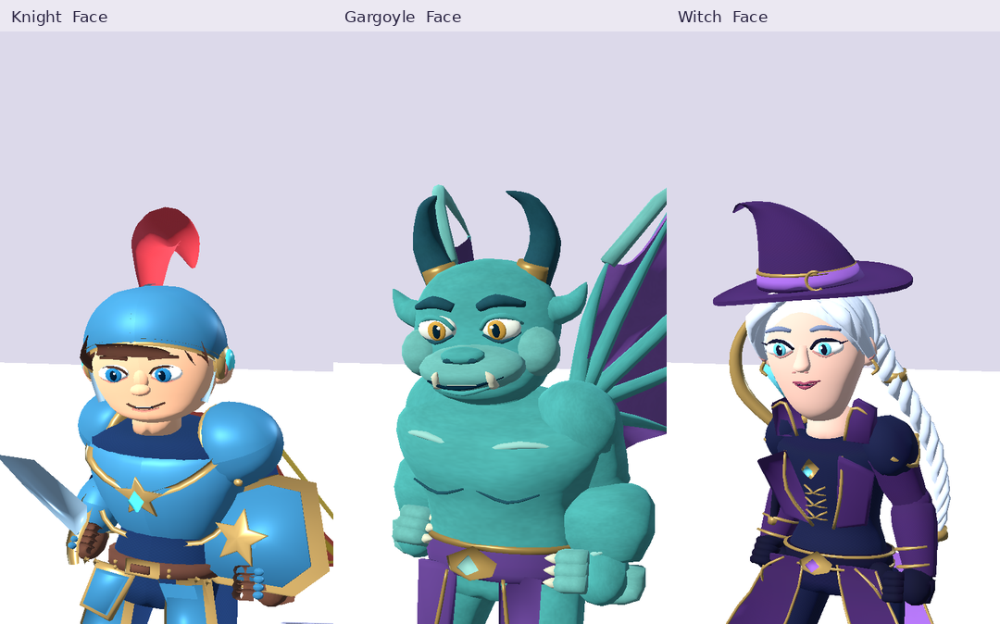
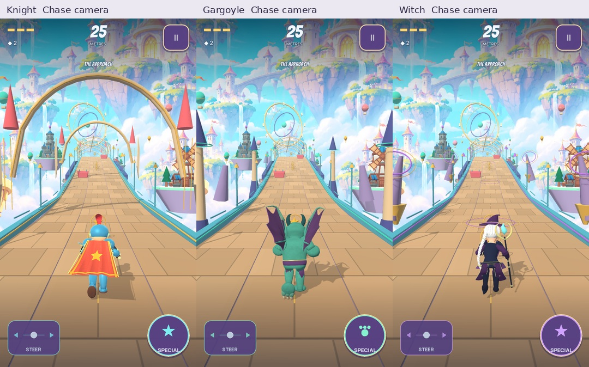

# Character material and surface finish

Lamont Labs · November 4, 2026 · follows source `24c2f10fe60ff2aa73c2ffc5b8aa54a70b35efc6`

Knight, Gargoyle and Witch now use separate satin metal, enamel, cloth, leather, stone, wing and hair treatments within their existing single imported material surface. This is a material iteration on the saved three-character cast. The three GLBs, rigs, morph targets, equipment geometry, collision rules and gameplay rules are byte-for-byte unchanged.

## Actual imported actors

The front and rear stage views use the existing fixed camera and lighting recipe. The face views and chase frames use the actual playable actors. These are desktop development captures, not phone-performance evidence or final owner art approval.

## Surface treatment

| Surface | Treatment |
| --- | --- |
| Knight armor and metal trim | Satin roughness and stronger metal response; blue enamel retains its broad authored gradients |
| Cloth | Restrained weave with distance fading; costume seams and embroidery remain modeled |
| Leather | Low-contrast grain |
| Gargoyle stone | Broad irregular painted mineral variation, preserving the clean facial features |
| Gargoyle wings | Softer broad variation than the body stone |
| Hair | Directional strands and a restrained painted sheen |
| Skin and eyes | Preserve clean authored paint; exclude cloth, stone, leather and hair detail |

`tools/build_character_finish.py` creates an original periodic 256 × 256 RGBA data texture. Its channels contain stone variation, cloth weave, leather grain and hair strands. It has no external asset dependency, purchase, account requirement or generated-image dependency. A second bake reproduced the exact SHA-256 `47b20b6ac6fd2d340979fc98b54694fba70951ac853274ae464f6e97b357e457`.

The shader identifies the current authored material regions from the unchanged secondary-UV metallic/roughness pairs and, where the Gargoyle sash shares a roughness value with stone, the authored purple/green pigment. This is a contract with these known model revisions; future palette or parameter changes require reviewing the finish classification. The data texture is sampled without sRGB conversion or alpha-border processing, with mipmaps, a finite explicit LOD for constant-UV trim plates and screen-size fading for fine detail.

The main imported surface gains one texture lookup per fragment and no extra material pass or geometry. The 256² RGBA mip chain has a theoretical uncompressed size of 349,524 bytes. This is a resource budget, not a measured Android frame-time result. Hero LOD work remains open pending physical-device profiling.

## Verification

The actual engine review covered front, rear, side, run, attack, jump, slide, celebrate and five facial expressions for every character, plus before/after finish controls using the same cameras. Three eight-second scripted chase captures were also reviewed. Constant-UV trim was specifically rechecked after correcting a texture-filtering artifact found during development.

Local checks passed 863 Godot assertions, 20 Python tests and 51 asset inventory checks. Each character completed a 3,600-tick basic-only run of 1,311.507 m with zero damage, deaths, handoffs or off-screen runner-centre ticks. The eight-second rendered chase checks preserved the selected character. Detailed source fingerprints and render receipts are retained with the private build verification records; the public checkpoint contains the game changes and review sheets.

## Android delivery scope

The owner-update signing key is not available in this workspace. The requested installable delivery uses a separate **Mystic Run Art Preview** package, `com.lamontlabs.knightgargoylewitch.artpreview`, with an independently preserved development signing identity. It installs alongside the existing game and uses its own save data. It is not an update to the owner-signed `com.lamontlabs.knightgargoylewitch.dev` package and is not a Play release. The existing owner signing identity and published build 1016 are preserved.

`tools/build_android.py --art-preview` selects this separate identity explicitly. The normal signed build path now rejects any certificate other than the established owner certificate. Both variants retain the manifest permission and architecture checks. The actual preview artifact record follows in `ART_PREVIEW_BUILD.md` after export and verification.
