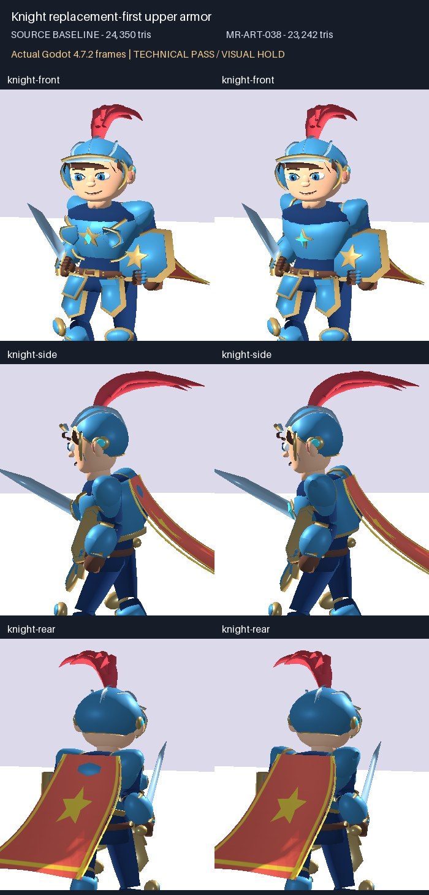
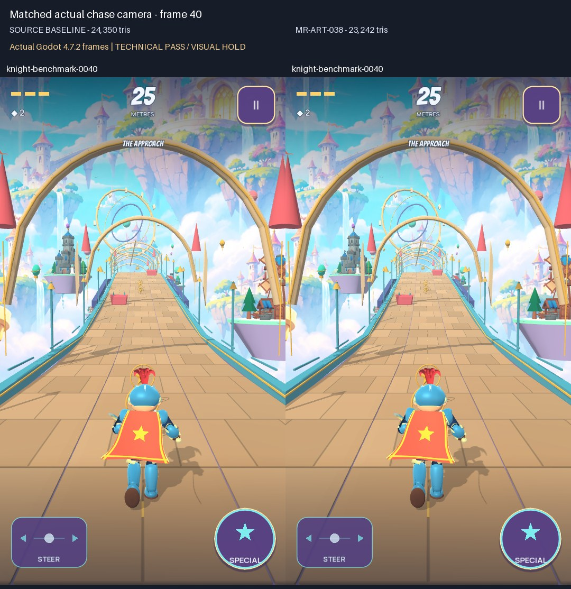
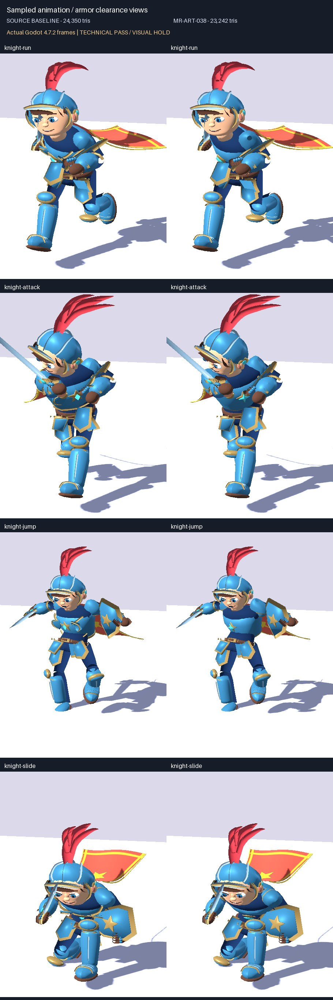

# MR-ART-038 — Replacement-first Knight upper armor

Date: 2026-11-14  
Issue: https://github.com/Lamont-Labs/Mystic-Run/issues/11  
Branch: `art/mr-art-038-replacement-armor`  
Decision: **CONCEPT-ALIGNED FRONT/REAR ART / ACTION-POSE LIMITATION**

## Source authority and preservation

- Started from imported `main`, `e100529ed53739a31b9a8bbf4392ece3fd8c90cf`,
  with an initially clean worktree. Its upstream game baseline is
  `3e766f680fc20f78ffada5ac7d4f6df33e747e6d`.
- Inspected live `art/asset-upgrade-batch-01` at
  `31d4849c45cf6661dd806ac0e13019169719fc34` (latest Knight generator work,
  including the partial MR-ART-038 chest tint) and
  `art/runtime-asset-integration` at
  `d775bc562f3ac5f4de62dd76cd553b014bfa4388` (newer general asset integration).
  There were no open PRs when inspected.
- The imported Knight generator and Knight asset files were byte-identical to
  the Knight art branch. Retained the newer imported game/integration source
  rather than checking out an older art branch over it. Original commits and
  source remain available; this work is on a separate branch.
- **Important:** the committed GLB was stale relative to its generator.
  Rebuilding the untouched generator in a separate baseline worktree produced
  the MR-ART-037 count of 24,350 triangles. The original committed GLB has
  24,328. Both baselines were preserved, hashed and rendered. Helmet/plume
  differences from the original committed GLB are inherited source changes,
  **not** new helmet/plume work in this pass.

## Bounded replacement

Replaced the existing round breastplate, floating lateral insets and tube
edging with a closed, waist-tapered cuirass with a broad front ridge and a
lowered front neckline. Replaced each old shoulder shell/rim/ridge with two
overlapping shaped lames and integrated gold bindings. Replaced the existing
chest emblem with a dimensional four-point turquoise star and gold binding.
Assigned armor-only satin metallic/roughness values and broad deterministic
vertex-painted enamel gradients; retained steel-blue/gold identity.

The original GLB replacement introduced no new rig, animation clips, material
draw calls, external models, bitmap textures, paid services or runtime
behavior. The later 2D gameplay presentation is described below. The head,
helmet/plume source, boots, lower armor, face, weapons and cloak source were
not reauthored. Broad gold edge separation, richer armor sculpting and the
existing helmet/limb presentation were not part of this bounded 3D pass; it is
not a full-character redesign.

## Exported asset measurements

| Asset | Actual indexed triangles | GLB bytes | SHA-256 |
| --- | ---: | ---: | --- |
| Original checked-in GLB | 24,328 | 1,662,012 | `1be8296c2effc4c2a8b8b42ee529e8ca764dcf9af6923fc49ba6279c56c4bf23` |
| Untouched source rebuilt locally | 24,350 | 1,682,912 | `f87a74d4d4f70a511305ebcbeb2998f7aa665e74427e010e9a2bccb623c961f3` |
| MR-ART-038 candidate | 23,242 | See [machine report](evidence/mr-art-038/after-structural.json) | `0600c08ef102d93d8a15205b667ad18ea825eaf5ebd96ad97decfa0b1f39bc97` |

Savings versus rebuilt source: **1,108 triangles**. Remaining budget:
**1,758 triangles** below the hard 25,000 ceiling. Actual exported indices
were counted, not just manifest values.

- Exactly **65 named bones**, identical hierarchy, local rest transforms and
  inverse-bind matrices versus the rebuilt source baseline.
- Exactly six exported, nonzero morphs: **Blink, PlumeSway, Smile, Focus,
  Surprised, Hurt**.
- One mesh, one skin, one material primitive; 13 baked painted material
  regions remain represented by vertex colors and metallic/roughness UVs.
  The actual exported material-slot list is in the machine report; the
  descriptive painted regions are not 13 draw calls.
- Verified finite position/morph streams, valid indexed triangles, valid
  joint indices and normalized skin weights, including sparse GLB morphs.
- Canonical position, paint, UV, material-parameter, weight and morph-position
  hashes matched across **14 non-upper-armor skin regions**, including Head,
  hands, calves, feet and pelvis. Spine_03 and both upperarm groups are
  excluded because they contain the intentionally replaced armor.

## Actual matched Godot evidence

Both source-baseline and candidate frames used the unchanged game-owned
preview scripts, Godot **4.7.2 stable**, Compatibility renderer, software Mesa
llvmpipe, **540 × 960**, and fixed 30-fps rendering. Both assets were exported
with **Blender 4.4.3** in the same local environment. This differs from the
existing GitHub rebuild workflow's pinned Blender 4.3.2; no hosted rebuild
result is claimed here.

The comparison sheet crops use identical rectangles without rescaling either
character independently. Original uncropped PNG hashes and camera labels are
in the [capture/region report](evidence/mr-art-038/capture-and-region-report.json).







Reviewed front, side, rear, run, attack, jump, slide and chase stills. The
floating chest inset/tube clutter is removed and the shoulders have a more
defined plate outline. The sampled baseline rear cape had a visible blue
armor intrusion that is not apparent in the candidate rear capture.
These are sampled observations, not full-animation clipping clearance. They
describe the preserved 3D fallback asset; gameplay now presents the 2D
concept cutouts documented below.

## Technical checks

See [run summary](evidence/mr-art-038/run-summary.json) and structural reports.

- Headless import: passed for original GLB, untouched source rebuild and
  candidate; no script/import errors.
- Gameplay core: **427 assertions, zero failures**.
- Eleven Godot suites passed: core, runner controls, asset districts,
  adventure, scene interactions, tilt/elevation, rig motion, Knight
  expressions, Knight cloth response, Gargoyle asset and Witch asset.
- Three separate **3,600-tick** basic scene runs passed, one per character.
- Existing rig tests exercised motion, combat blending, finite transforms
  and slide clearance. No new exhaustive triangle-intersection detector
  was added; animation clearance is not certified by still images.
- Source-baseline and candidate seeded chase benchmark JSON matched exactly:
  100 frames, 30 recording fps, 62.224 m, zero damage, zero handoffs, selected
  Knight preserved.
- Nine new verifier contract tests passed, including an actual over-budget
  index stream, forged triangle count, missing/renamed morphs, changed rest
  rig, duplicate bone names, NaN positions and sparse morph decoding.
- Asset rights/hash inventory: **51 checks passed**; ten existing foundry
  unit tests passed. The Knight's exact binary record was updated without
  changing rights metadata.

## Approved concept and selected 2D gameplay presentation

The owner supplied and explicitly approved the complete 1536 × 1024 sheet on
November 14, 2026. Its exact binary is now tracked at
`references/01-character-concept.png`; SHA-256:
`07e7541d8d5a91d1733186930d5d4ed759400021c8af3391f068ade217f01e71`.
See [the owner-approved reference record](MR_ART_030_APPROVED_CONCEPT_REFERENCE.md).
This resolves the missing-image blocker. The owner also explicitly said the
characters do not have to be 3D.

The owner chose concept fidelity over a 3D-only presentation. The game now uses
2D cutouts derived from the exact approved PNG for all three playable
characters. The extraction script crops the supplied front and rear poses,
removes only the connected pale backdrop, and records source and output hashes
in `assets/characters/concept-sprites/PROVENANCE.json`. Character RGB pixels
come directly from the approved sheet; no paid service, generated art, or
redrawn character pixels were used.

The owner authorized use in MysticRun on a noncommercial basis only.
`assets/asset_registry.json` records commercial use as disallowed, game
distribution as allowed, and required credit; the game Credits screen and
`assets/licenses/mysticrun-owner-provided-noncommercial.txt` state that limit.
This is not a commercial-use license.

Actual gameplay captures for all three characters are in
[the concept-sprite gameplay preview](previews/mr-art-038/concept-sprites-gameplay.jpg).
The game selects the front or rear supplied view based on facing. Existing run
bob, movement, jump, slide squash, attack timing, and gameplay effects continue.
Because the sheet contains only front and rear stance illustrations, each
sprite moves as one illustrated figure: it does not have limb-by-limb run,
jump, slide, or attack poses. This is the selected trade-off, not a claim of
full action-animation fidelity.

The existing GLBs remain in the project, hidden from rendering but loaded with
their skeletons, skinning and morphs for compatibility, verification, and
future fallback. The Knight still has exactly 65 bones, six morphs, and
23,242 exported triangles under the 25,000 limit. The MR-ART-038 replacement
armor asset remains preserved; current gameplay presentation now uses the
approved 2D illustration instead of that model.

The supplied front and rear images are directly derived from the approved
artwork. Their static-view appearance is concept-aligned. Pose-specific 2D
artwork is not present, so action-pose matching remains limited to whole-sprite
motion. The earlier [3D cast comparison](previews/mr-art-038/concept-vs-current-cast.jpg)
is retained as historical evidence for why the owner chose the 2D path.

No physical Android or sustained performance is claimed. The supplied static
front/rear illustrations are directly represented; no action-pose art is
claimed. No Android identity/export preset/signing configuration changed; no
signing keys, APK/AAB, release or merge were produced. The dedicated branch
does not match the Android build/publish push triggers.

## Reproduction

Keep baseline and candidate assets separate; do not overwrite the original
GLB to create a comparison. The full local evidence and original raw captures
are retained under ignored `generated-artifacts/mr-art-038/`.

```bash
python3 tools/bootstrap_godot.py --cache engine-tools/godot
blender --background --factory-startup --python-exit-code 1 --python tools/build_knight_asset.py
python3 tools/verify_knight_glb.py --baseline path/to/rebuilt-baseline/knight.glb
python3 -m unittest discover -s tools -p test_verify_knight_glb.py
engine-tools/godot/Godot_v4.7.2-stable_linux.x86_64 --headless --path . --editor --import --quit
python3 tools/render_preview.py --godot "$PWD/engine-tools/godot/Godot_v4.7.2-stable_linux.x86_64" --output "$PWD/generated-artifacts/mr-art-038/after/stage" --character knight --script res://tests/preview_authored_character.gd --frames 120
python3 tools/render_preview.py --godot "$PWD/engine-tools/godot/Godot_v4.7.2-stable_linux.x86_64" --output "$PWD/generated-artifacts/mr-art-038/after/chase" --character knight --script res://tests/preview_character_benchmark.gd --frames 100
python3 tools/review_knight_armor.py --before-glb path/to/rebuilt-baseline/knight.glb --before-renders path/to/baseline-captures --after-renders generated-artifacts/mr-art-038/after --output generated-artifacts/mr-art-038/review
```

`review_knight_armor.py` needs Pillow 13.0.0 (declared in `pyproject.toml`).
The Replit configuration supplies Blender and Xvfb/software-rendering
libraries. Harmless local warnings were missing optional `libxkbcommon`
and unavailable Xvfb VSync; actual OpenGL frames and all exit codes succeeded.
There is deliberately no replacement web app or unrelated run workflow.
